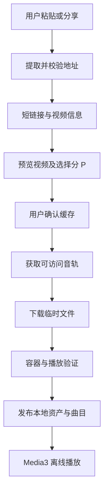

# B 站音频缓存与新闻采集设计

日期：2026-11-27。状态：实施草案，尚未完成真实接口或手机验证。

本设计细化 [总体技术设计](TECHNICAL_DESIGN.md) 中的 B 站缓存与新闻数据源，供 Android 工程实施使用。[需求文档](REQUIREMENTS.md) 是产品范围依据；本文中的候选技术与参数不代表已获得产品确认。

建议先用 yt-dlp 在开发环境验证 B 站样本，再评估 Kotlin 原生适配；生产 App 默认不嵌入 Python、不新增解析服务器。新闻建议采用 RSS/Atom 直接订阅、RSSHub 作为可选补充，但实际来源与交付排期仍待确定。

## 范围与边界

| 模块 | 当前目标 | 暂不包含 |
|---|---|---|
| B 站 | 分享文本与链接识别、短链接、普通视频与分 P、音轨缓存、离线播放 | 登录、会员或付费内容、直播、任意站点解析、强制 MP3 转码 |
| 新闻 | 定义统一数据模型、采集适配与阅读路径；保留示例 UI | 未经确认的具体站点、后台高频轮询、自动 AI 摘要、个性化推荐 |

两个模块不访问独立加密安全笔记或 AI 凭据。解析、下载、订阅读取分别使用独立网络配置，不共享认证头或自动携带其他模块 Cookie。

## B 站路线选择

| 路线 | 用法 | 取舍 |
|---|---|---|
| Kotlin 原生适配 | App 直接请求视频信息与音轨资源，交给下载队列 | 依赖少、符合本地优先；平台变更需要发版或经过审核的配置更新 |
| yt-dlp 开发验证 | 仅在开发机运行，记录格式、必要请求头与失败分类 | 先证明样本可获取，不代表 Android 原生实现已完成 |
| yt-dlp Android 封装 | 原生路线成本过高时的候选 | 必须测量安装包、启动、ABI、系统页大小、更新策略及许可证；未决定接入 |
| 自建解析服务 | 未来明确需要时另立方案 | 引入运维、链接上传和可用性依赖，当前不采用 |

yt-dlp 当前维护的 B 站提取器包含 WBI 签名、播放信息与 DASH 音轨提取逻辑，可供验证与理解协议，但属于社区实现，不是 B 站的稳定 API 合约。[提取器源码](https://github.com/yt-dlp/yt-dlp/blob/master/yt_dlp/extractor/bilibili.py)

[youtubedl-android](https://github.com/yausername/youtubedl-android) 提供 Android 封装，可作为替代验证对象；不得未经兼容性验证直接复制其全部存储与运行配置。

若原生路线在当前网络与普通公开样本上不稳定，应提交失败证据与替代路线测量，不能靠无限重试、默认添加用户登录凭据或悄悄接入第三方解析站解决。

## B 站处理流程



链接解析预览属于用户主动发起的联网操作；预览不下载音频正文。用户确认分 P 后才创建下载任务。分享入口不直接执行任意 URL，也不自动读取剪贴板。

### 输入与重定向

一期接受 HTTPS 的 bilibili.com/video/ 视频页面及 b23.tv 短链接，分享文本内可提取地址。末尾中文标点不作为地址的一部分；多个地址要求用户选择。域名必须按解析后的 host 判断，拒绝伪装子域、用户名片段、非 HTTPS 协议和私网目标。

短链接展开每跳重新校验，建议最多 5 次；禁止使用会在未校验前自动跟随全部重定向的网络配置。DNS、连接目标与最终地址都要按网络策略校验，不能仅对原始字符串做后缀匹配。

输出稳定视频标识及分 P 标识；不将临时 CDN URL 保存为曲目身份。AV 等额外输入形式只有在样本验证后才加入支持矩阵。

### 视频预览与资源选择

预览包含标题、作者、封面、时长、视频 ID、分 P ID 和分 P 标题。选定分 P 后解析音轨，优先选择目标机可解码的常见音频编码；不可播放的音轨不因码率高而被优先选中。

社区提取器展示了通过播放信息获取独立音频资源的路径，可作为原生实现的研究依据。具体端点、签名字段与必要请求头必须由适配器封装，并以保存日期的测试结果固定，不将浏览器接口当成永久可用的公开协议。[音轨与播放信息实现](https://github.com/yt-dlp/yt-dlp/blob/master/yt_dlp/extractor/bilibili.py)

默认不下载完整视频以提取声音，不强制转 MP3。若响应只有混合音视频而无可用独立轨，一期提示不支持；是否增加提取或转封装需另行评估体积、性能和支持格式。

## B 站接口与模型

```kotlin
interface BiliSourceResolver {
    suspend fun preview(input: SharedLink): VideoPreview
    suspend fun resolveAudio(selection: PartSelection): AudioResource
}

interface AudioDownloadRepository {
    suspend fun enqueue(selection: PartSelection): TaskId
    fun observe(taskId: TaskId): Flow<DownloadState>
    suspend fun cancel(taskId: TaskId)
    suspend fun retry(taskId: TaskId)
}
```

| 模型 | 关键字段 |
|---|---|
| VideoPreview | videoId、title、author、duration、parts、canonicalUrl |
| PartSelection | videoId、partId、partTitle、sourceRevision |
| AudioResource | url、backupUrls、codec、container、bitrate、expectedLength、allowedHeaders、有效期信息（若可知） |
| DownloadTask | id、sourceKey、状态、临时资产、已下载字节、总量、尝试次数、错误码、更新时间 |
| TrackSource | sourceType=BILIBILI、videoId、partId、原始链接、标题快照 |
| AudioAsset | id、路径、内容散列、长度、容器、编码、校验状态 |

sourceKey 由来源、视频 ID 与分 P ID 构成并唯一约束，防止重复任务。下载时保留明确的任务 ID；新曲目插入不改变当前播放曲目的身份，禁止以可变列表下标作为播放器长期标识。

AudioResource 中临时地址及必要头只能由下载层取得，不放普通日志、备份或可分享的错误详情。不能从请求失败响应复制未经筛选的任意请求头再次发送。

## 下载与文件一致性

```text
QUEUED -> RESOLVING -> DOWNLOADING -> VERIFYING -> READY
    |          |             |            |
    +----------+-------------+------------+-> FAILED
               用户取消 -> CANCELED
               可恢复等待 -> PAUSED
```

READY 必须同时满足：文件完整性与容器检查通过、本地可播放探测通过、资产已发布且数据库引用正确。无法取得 Content-Length 时展示字节数，不虚构百分比。

建议下载并发为 1，短暂网络失败最多自动重试 2 次并退避；鉴权、受限、格式不支持不自动重试。用户可手动重试，重试要重新判断来源和已完成资产。

续传前检查分 P 与格式身份；校验 Range/Content-Range、ETag 或可用的资源身份信息。服务端返回 200 全量时从头写，不能接在旧文件后。临时 URL 到期后重新解析；无法证明同一资源则重新开始，不跨不同编码拼接字节。

下载到应用私有临时文件，验证后在同一文件系统原子改名；数据库由 PREPARING 切 READY。启动扫描未完成任务，回收无引用临时文件或恢复等待，不自动清除用户已经确认保留的音频。

优先验证 Media3 DownloadManager/DownloadService，来源解析和地址刷新仍由适配器完成。[Media3 离线下载](https://developer.android.com/media/media3/exoplayer/downloading-media)

长下载后台执行按目标 Android 版本适配，不能把 WorkManager 视为无限保活。Android 16 的长时 Worker 存在任务配额影响，需要实机验证用户发起的传输机制。[后台任务说明](https://developer.android.com/develop/background-work/background-tasks/persistent/how-to/long-running)

## B 站错误分类

| 分类 | 页面行为 | 是否自动重试 |
|---|---|---|
| 无效或不支持链接 | 指出支持范围，保留输入 | 否 |
| 视频不存在、已删除 | 展示明确原因，已有本地资产不受影响 | 否 |
| 需要登录、付费或其他权限 | 提示一期暂不支持 | 否 |
| 限流或平台风控 | 提示稍后再试，停止批量请求 | 不立即重试 |
| 临时地址过期 | 有限重解析；无法续传则说明重新开始 | 有限 |
| 网络中断 | 保留任务与可验证的临时文件 | 有限 |
| 空间不足 | 暂停，提供清理后重试入口 | 否 |
| 未知响应结构 | 记录脱敏的错误码与适配器版本，提示解析暂不可用 | 否 |
| 无音轨或编码不支持 | 明确不支持，不生成虚假已缓存曲目 | 否 |

## 新闻数据源方案

技术优先级为站点原生 RSS/Atom、用户选定 RSSHub 地址、官方 API、最后才是逐站点 HTML 适配。RSSHub 能将多类网站内容转换为订阅格式；使用实例时需要接受对应实例的可用性与更新依赖。[RSSHub 项目](https://github.com/DIYgod/RSSHub)

本期不部署 RSSHub，也不写入未经确认的默认站点。对 App 来说 RSSHub 输出仍按 Feed 类型处理，保留其原始内容来源与中转实例，不把中转站标成新闻作者。

普通 RSS 聚合可以手机直连；使用 RSSHub 时手机连接选定实例；后续若使用付费 API，API Key 需要独立凭据命名空间，不能复用 AI 凭据或安全区数据。

### 采集接口

```kotlin
interface NewsSourceAdapter {
    suspend fun fetch(source: NewsSource, cursor: FetchCursor): NewsFetchResult
}

// NewsFetchResult: Unchanged / Updated(items, cursor) / Failed(error)
// FetchCursor: ETag、Last-Modified 与来源适配器版本
```

| 实体 | 关键字段 |
|---|---|
| NewsSource | id、名称、类型、订阅地址、启用状态、用户分类、更新时间、错误状态 |
| Article | id、sourceId、来源 guid、canonicalUrl、title、author、publishedAt、fetchedAt、summary、cover、contentState |
| ArticleBody | articleId、正文、清理版本、来源、获取时间、缓存大小 |
| ReadState | articleId、已读状态、阅读位置；是否实现由实际功能范围确定 |

新闻分类初期由来源配置映射，不能为了示例分类标签引入自动 AI 分类或推荐。publishedAt 缺失时显示“发布时间未知”，不能把 fetchedAt 冒充新闻发布时间。

## 新闻刷新与去重

前台手动刷新作为首个实现路径，独立来源并发最多 3 个、每来源同一时刻一个任务。建议短时间重复刷新复用结果，初始最小间隔 60 秒；真正后台周期刷新需用户确认并说明系统不保证精确时间。

RSS/Atom 使用条件请求保存 ETag 与 Last-Modified，304 视为无变化。每来源失败单独记录，不清空此前成功内容；刷新反馈包括成功、无变化和失败数量。

同一来源优先以稳定 guid 去重，缺失时以规范化原文 URL 去重；两者都没有时用标题与发布时间生成弱键并记录置信度。不删除 URL 中所有查询参数，避免误合并不同文章；去跟踪参数使用明确名单。跨来源同题报道保留来源，不仅凭相似标题自动合并。

单来源每次响应建议最多 5 MiB、最多处理 200 条，正文懒加载；超限明确失败或提示受限，不无声丢弃历史。最终阈值随实际来源确定。

## 新闻正文与安全

Feed 提供完整正文时先清理 HTML 再展示；只有摘要则显示摘要和原文入口。正文提取失败保留摘要，不把“已获取标题”显示成“全文已缓存”。

优先 Compose 原生正文或受限富文本组件；不默认使用可执行任意脚本的 WebView，不启用 JavaScript bridge。移除 script、iframe、表单、事件属性及危险 URI；XML 禁止 DTD 与外部实体并限制展开规模。封面与正文图片经过单独资源策略，不自动加载追踪像素或任意第三方资源。

站点 HTML 全文提取只对明确允许支持的来源逐项适配，不承诺所有网站都可离线全文阅读。打开原文交给系统浏览器，并在联网关闭时说明需要联网。

新闻缓存默认只保留可重建内容；建议文章数量和体积上限分开控制，例如 1000 条列表、正文与图片总计 100 MiB 作为待测基线。与用户明确保留的音乐资产分开清理。

## 验证计划与验收证据

| 编号 | 样本 | 必须验证的结果 |
|---|---|---|
| BN1 | B 站标准视频与短链接 | 正确预览、身份相同、重定向受限 |
| BN2 | 多分 P | 仅缓存用户所选部分，曲目与音轨正确对应 |
| BN3 | 长音频、地址过期、断网续传 | 无音视频拼接错误，失败可恢复且重试有限 |
| BN4 | 已删除、登录或其他受限内容 | 有明确失败分类，不生成 READY 资产 |
| BN5 | 下载取消、空间不足、进程终止 | 已完成缓存不损坏，半成品不进入离线曲库 |
| BN6 | 缓存完成后断网重启 | 能播放、拖动和切歌，不再解析远程链接 |
| BN7 | RSS 2.0、Atom、缺字段与乱码 | 标题、来源、时间语义正确，格式错误不污染旧列表 |
| BN8 | 同 guid 更新、同题不同源、304 | 正确更新和去重，不误删跨源内容 |
| BN9 | 单来源超时、恶意 XML/HTML、超大响应 | 单源失败隔离，无脚本执行、外部实体与无限资源消耗 |
| BN10 | 只有摘要、全文失败、离线缓存 | 显示实际内容状态与原文入口，不宣称全文已读 |

每个验证记录日期、适配器版本、目标 Android 版本、网络条件、脱敏来源标识、预期与结果。禁止提交 Cookie、签名下载 URL、密钥与真实敏感内容。

## 待定与实施顺序

1. 准备用户有权缓存的 B 站样本，先验证开发环境提取与独立音轨格式；保存结论，不保存敏感 URL 参数。
2. 用 Kotlin 适配器完成同样本预览和音轨获取，比较行为与维护成本；失败时再评估 Android 封装，不预先引入运行时。
3. 接入持久下载队列和 Media3，完成断网重启与进程终止测试，再将界面中的模拟缓存替换为真实能力。
4. 新闻继续使用 FakeNewsRepository；用户确定来源后先接入少量 RSS/Atom，验证真实格式再扩大数量。
5. 根据真实来源决定是否增加 RSSHub、正文提取和后台刷新；这些不是当前已确认的新闻需求。

当前没有完成任何 B 站真实缓存或新闻真实源联调。本文解决实施路径，不把源码研究当作已验证成功率。
