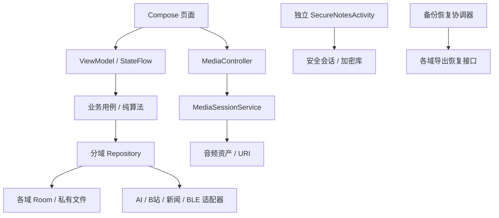

# ptoolbox 总体详细设计（含 Demo 设计）

版本：0.2；更新日期：2026-11-27；状态：开发设计基线，待工程与真机验证。

本文统一描述 Android 手机 App 的产品结构、页面、交互、数据、服务、安全和实施验收。设计参考当前 [需求文档](REQUIREMENTS.md)、[技术设计](TECHNICAL_DESIGN.md)和[手机 Demo](../demo/index.html)。需求冲突以需求文档中的明确约束为准；本文中的实现建议不表示已获得实测结论。B 站与新闻的协议细节见[专项设计](BILI_NEWS_DESIGN.md)，接手工作见[交接文档](HANDOFF.md)。

## 1. 产品定位与范围

ptoolbox 是个人使用的 Android 工具箱。本地数据优先，无应用账号和云同步；只有用户使用 AI、B 站缓存或后续新闻源时，对应模块联网。正式产品采用原生 Android 实现，HTML Demo 用来确认视觉与交互，不作为 WebView 打包方案。

| 范围 | 内容 | 本文处理方式 |
|---|---|---|
| 已明确 | 首页、可排序的四项导航、独立加密安全笔记入口 | 固定信息架构 |
| 已明确 | 独立加密安全笔记、加密备份恢复 | 安全门槛优先于便利与进度 |
| 已明确 | AI 多角色、多会话、图片和 PDF/TXT/Markdown 问答 | 按能力适配服务商，不假设所有模型都支持附件 |
| 已明确 | 本地音乐、B 站链接缓存、后台播放、歌单、歌词 | 先验证解析与播放，再完成持久化闭环 |
| 已明确 | 油耗、体脂秤迁入 | 先核对旧算法、格式与设备 |
| 待确认 | 新闻来源、真实分类、正文形式及排期 | 先保留虚构示例和可替换接口 |
| 明确排除 | 密码管理器 | 不提供密码条目、密码库入口或第三方密码库导入 |
| 明确排除 | AI 操作手机 | 不增加无障碍、屏幕捕获、模拟操作或悬浮窗执行能力 |
| 明确排除 | 已拒绝的扩展建议 | 不加入密码生成器、密码历史、密码健康检查、收藏、备份提醒、会话内搜索与导出、油耗月报和体重目标 |

会话列表搜索与会话内搜索是不同能力，前者按已有需求保留。手动备份恢复保留，不以提醒功能为前提。

## 2. 全局信息架构

```text
应用
├─ 首页（默认启动页）
│  ├─ 普通工具卡片：音乐、新闻、AI、油耗、体脂、安全笔记入口
│  ├─ 导航排序
│  └─ 普通设置 / 手动备份恢复入口（正式版位置见第 4 节）
├─ 音乐
│  ├─ 正在播放、曲库、来源筛选
│  ├─ 歌单列表 → 歌单详情
│  ├─ 歌词面板
│  └─ 更多 → 本地添加 / B 站添加 / 查看下载任务
├─ 新闻
│  └─ 示例分类 → 头条与列表 → 文章详情
└─ AI
   ├─ 角色选择 → 角色管理 → 角色编辑
   ├─ 会话列表 → 会话详情
   ├─ 图片 / 文档附件 → 附件状态与详情
   └─ 服务商及模型配置
```

默认底部导航仅为「首页、音乐、新闻、AI」，允许排列顺序，不允许增加第五项或移除某项。工具子页归属首页返回栈。安全区走独立认证入口，不在普通返回栈保存明文或解锁态。

每个顶层页保留自己的滚动位置与普通页面状态；重排导航不重建播放器、不切换当前页面。重启后恢复导航排列，默认打开首页；恢复普通草稿与最近播放记录不等于恢复播放或安全区解锁。

## 3. Demo 视觉设计与组件规范

### 3.1 设计方向

采用浅背景、白色卡片、深绿色强调色，保持轻量的生活工具感。音乐封面使用抽象几何和柔和渐变，新闻使用大图头条与紧凑列表，AI 使用角色胶囊与聊天区域。安全笔记仅提供通用工具卡片，不显示正文摘要。

当前 Demo 的主文件为 [demo/index.html](../demo/index.html)，旧版 [prototype.html](../demo/prototype.html)仅作历史参考。桌面以约 414 × 880 CSS 像素手机外框呈现；窄屏铺满视口。这是展示容器，不限制正式 App 只能支持这一种尺寸。

| 设计项 | 当前 Demo 值或表现 | 正式 App 映射 |
|---|---|---|
| 主色 | `#166C5B` | Compose colorScheme 的品牌色 |
| 正文色 | `#172B2A` | 高强调正文，按实际背景检查对比度 |
| 次要文字 | `#768382` | 需验证小字号对比度，必要时加深 |
| 分割线 | `#E7ECEB` | 低干扰列表分隔 |
| 轻强调背景 | `#EAF4EF` | 选中、标签、图标容器 |
| 应用背景 | 手机区域以 `#F7F9F7` 为主 | 页面背景 |
| 形状 | 卡片约 16–22px，面板约 24px 圆角 | 统一映射为 dp token，不逐页随意配置 |
| 间距 | 以 4 为基准，常用 8/12/16/20/24 | 使用统一 spacing 定义 |
| 字体 | 中文系统字体与系统无衬线 | Android 系统字体，正文建议 14–16sp |
| 触控 | Demo 部分按钮约 40–42px | 正式版交互区域至少 48dp，图标可小于触控区域 |

正式布局必须处理状态栏、手势导航、刘海、输入法与字体放大。不要复制 Demo 的固定高度限制；聊天输入区随输入法抬起，底部内容不被导航与播放条遮挡。深色模式是否纳入首版不在本文默认承诺范围。

### 3.2 通用组件

| 组件 | 展示与行为 |
|---|---|
| AppTopBar | 标题、返回、最多两项直接动作；低频操作放更多菜单 |
| ToolCard | 图标、名称、一行描述；敏感内容不得进入卡片摘要 |
| BottomNavigation | 四项、图标加文字；选中不只靠颜色区分 |
| ModalBottomSheet | 添加、排序、角色选择等短任务；复杂编辑允许独立全屏页 |
| StatePanel | 加载、空、失败、离线；提供与当前失败匹配的动作 |
| ConfirmDialog | 删除、覆盖前说明对象及影响；取消为安全默认项 |
| InlineError | 表单字段旁展示错误，保留已输入内容 |
| MessageNotice | 普通操作结果短暂提示；关键失败持续可见，不仅依赖 Toast |
| AttachmentChip | 文件名、类型、处理状态、移除；图片可带缩略图 |
| TrackRow | 封面、标题、来源与状态；点击播放，更多动作可访问 |

弹窗关闭后焦点回到触发入口；系统返回先关闭面板再退出页面。普通编辑有未保存改动时提示放弃；安全区锁定优先于保留敏感编辑草稿。

## 4. 页面详细设计

### 4.1 H01 首页与 H02 导航排序

页面从上至下为标题和排序入口、轻量欢迎区、工具网格、普通示例概要、底部导航。首页不展示笔记标题、正文或最近访问。安全笔记卡片只能展示通用描述与锁定状态。

正式版在首页右上角更多菜单提供普通设置及手动备份恢复入口；此处是实施布局建议，当前 Demo 没有完整设置页。敏感备份操作必须再次通过安全域认证，不能因入口位于普通设置而绕过认证。

排序流程：点击排序图标或长按底部导航 → 展示四项排列 → 前移/后移（正式版可增加拖动）→ 保存 → 写入 DataStore。取消不生效；恢复默认先改变草稿，保存后提交。读取失败或存储内容非法时回退默认，保留可重试入口。

### 4.2 N01 笔记认证、N02 笔记列表、N03 笔记编辑

首次进入：设置并确认笔记主口令 → 显示遗忘无法找回说明 → 创建安全存储 → 可选启用生物识别。再次进入展示锁定页，不预加载可见条目。解锁成功后进入笔记列表或指定笔记页面。

安全笔记列表仅在已解锁时展示条目，详情默认隐藏正文；编辑包含需求规定字段，保存成功后才关闭。安全笔记独立管理会话与加密库，字段为标题、正文、分类和时间，不提供账号或密码专用字段。条目搜索及索引同样位于安全域，不在普通数据库建立副本。

| 场景 | 行为 |
|---|---|
| 笔记主口令错误 | 保持锁定并展示剩余等待；退后台与重启不可绕过 |
| 生物识别失效 | 回退笔记主口令，不删除原数据或自动重建密钥 |
| 切后台、锁屏、离开安全区 | 先遮蔽 UI，再销毁会话、关闭库与清理明文引用 |
| 返回安全区 | 重新认证，不使用页面恢复机制重建明文 |
| 复制敏感字段 | 显式操作、到期清理；清理前核对剪贴板内容仍属于本次复制 |
| 写入失败 | 保留当前受保护编辑态，展示失败；锁定后不明文恢复草稿 |
| 修改笔记主口令失败 | 原封装仍有效；不可出现旧口令失效且新口令不可用的中间态 |

当前 Demo 只有虚构笔记与界面切换，不含笔记主口令认证、存储加密或真正防截屏，禁止输入真实秘密。

### 4.3 M01 音乐首页与 M02 播放详情

音乐首页顶部为标题和右上角 `···`，下方为正在播放卡片、歌单、来源筛选与曲目列表。添加入口仅置于更多菜单，避免大面积新增按钮。正式版将曲目状态区分为本地可用、等待缓存、下载中、失败、源文件不可用。

播放卡片包括封面、标题、来源、时间进度、上一首、播放/暂停、下一首、歌词入口。正式版播放详情可展开队列与播放模式；后台状态由播放器统一发布，页面不维护第二套播放布尔值。首版确切播放模式以需求为准，不通过视觉按钮暗示尚未实现的模式。

跨页迷你播放条作为操作完善建议：仅在存在有效播放项时出现，展示标题、播放/暂停、进入音乐；需与底部导航、键盘和安全区协调。进入安全区隐藏普通悬浮 UI；播放器可继续播放，但不得携带安全内容。当前 Demo 尚无跨页播放条，不把它写成已完成能力。

### 4.4 M03 添加音乐与 M04 下载任务

本地添加：更多 → 从本地添加 → 系统文件选择 → 校验可读性与格式 → 复制到私有持久目录 → 提取可用元数据 → 入库。取消不创建空曲目、不删除用户原文件。首版以私有副本作为长期资产，URI 仅用于读取，避免来源撤权后曲目失效；空间不足不发布可播放记录。

B 站添加：粘贴链接或分享文本 → 提取并校验地址 → 解析视频 → 如有多分 P 则选择 → 展示标题、来源与音轨信息 → 确认缓存 → 队列处理 → 验证完成 → 发布可播放资产。相同内容不得因不同分享链接重复生成任务；下载失败保留可理解原因和重试入口。

Demo 的「解析并缓存」是定时模拟，不显示为真实接口验证成功。正式版为解析、下载、校验提供分阶段反馈；未知长度显示不确定进度，不伪造百分比。

### 4.5 M05 歌单与 M06 歌词

歌单网格展示封面、名称和曲目数；详情展示有序曲目与播放入口。新建时校验名称；添加曲目支持多选与去重；从歌单移除不删除音频，删除歌单不删除曲库资源。正式版重命名与排序按既有需求落地，当前 Demo 尚未完成，不能将「播放第一首」误报为完整歌单队列。

歌词面板展示当前曲名和来源；有 LRC 时按播放器位置高亮，点击带时间歌词可定位；TXT 作为纯文本阅读。拖动阅读时暂停自动跟随，提供返回当前行的轻量入口。导入失败不覆盖原歌词；切换曲目取消上一曲歌词回调。无歌词展示导入入口，不自动加入尚未选定的联网搜词服务。

LRC 解析处理多时间标签、毫秒精度差异和 offset；不合法行按明确规则跳过或作为文本，不允许负数寻址。纯文本不能伪装为同步歌词。Demo 原创歌词仅演示排版。

### 4.6 A01 AI 工作台与 A02 会话

从上至下为标题、横向角色选择、角色管理/新会话、当前会话角色与模型摘要、消息区、附件区、输入区。正式手机布局使用独立会话列表页或侧面板，避免把桌面侧栏压缩进窄屏。列表支持已有需求规定的查找、切换与删除，不增加会话内搜索或导出。

点击角色只设置下一次新会话的候选角色；点击新会话创建角色配置快照。已有会话持续使用创建时的快照，编辑或删除角色不改变既有消息。页面同时显示会话角色，避免用户把角色选择器当前值误认为历史会话已变更。

发送流程：检查服务商和能力 → 检查附件与上下文预算 → 展示必要的首次发送说明 → 固化请求快照 → 写入用户消息及生成记录 → 请求 → 流式显示 → 完成并持久化。正在生成时提供停止；停止保留已收到内容并标记中断。自动重试不能重复创建用户消息或静默重复计费请求。

| 会话状态 | 页面表现 | 允许动作 |
|---|---|---|
| 空会话 | 角色介绍和输入框 | 输入、选附件、发送 |
| 附件处理中 | 附件逐项状态 | 移除、取消处理；必要附件未就绪时阻止发送 |
| 发送中/生成中 | 状态、增量文字、停止 | 停止；切页不把请求转移到其他会话 |
| 已完成 | 回复与必要引用 | 继续提问 |
| 失败 | 明确原因，保留用户消息 | 手动重试；不静默改模型或删附件 |
| 已中断 | 保留部分回复与标记 | 用户决定再次生成 |

### 4.7 A03 角色配置、A04 服务商配置与 A05 附件

角色编辑包含名称、系统提示词、默认服务商/模型及模型允许的参数。Demo 使用占位模型与「创造性」滑块；正式版只展示所选模型支持的参数，不能向不支持 temperature 的模型强行发送该字段。角色版本修改采用新增版本，历史会话引用快照。

服务商配置包含显示名称、HTTPS 地址、协议类型、模型及能力、受保护的 API Key。验证配置只发送明确的最小测试请求。Key 不回显完整内容、不进入普通日志、普通备份或 Demo localStorage。非官方端点必须让用户清楚接收方，禁止把同一鉴权头随跨域重定向转发。

附件选择支持图片、PDF、TXT、Markdown，按真实内容和可解码结果校验，不仅检查扩展名。附件卡片状态为选中、读取、提取、就绪、失败、已取消。移除文件同时取消解析并撤销待上传引用。

图片展示缩略图并按服务商限制处理；文本显示编码及截取范围；PDF 显示页数、可提取文字与已选择范围。扫描 PDF 无文本时明确提示，按已支持路径发送页面图像或告知不支持；不能回传空文本后宣称理解完成。不支持的模型在发送前提示更换或移除，不偷偷丢弃附件。

附件详情可查看将发送的文件/页码范围及处理结果。文档内容属于不可信输入，不能提升为系统提示或触发工具执行。安全区不出现在附件选择来源中，AI 无读取安全区接口。

### 4.8 N01 新闻列表与 N02 文章

Demo 使用「全部、科技、生活、设计」示例分类，首条大图头条，后续标题、来源、时间加缩略图列表；文章面板展示分类、标题、来源、正文及虚构说明。分类与来源均非最终接入承诺。

正式接入后保留旧内容进行刷新，显示上次成功时间；某一来源失败不清空其他来源。全文、摘要加原文链接、系统浏览器阅读三种形式应按来源授权与实际格式确定。App 内正文禁用任意脚本、危险协议与未经授权的外部子资源；不把 RSS 摘要冒充完整文章。

### 4.9 F01 油耗与 S01 体脂

油耗页面包括当前车辆、有效统计、记录列表、录入/编辑与已有 CSV 迁移入口。新记录校验里程、油量、金额、时间与满箱标记；历史编辑后重算受影响区间。非完整满箱区间不输出精确油耗，统计口径见第 8 节。

体脂页面包括当前成员、连接状态、测量、有效指标、趋势、历史与成员资料。连接流程为权限检查 → 扫描 → 用户选择设备 → 连接 → 协议识别 → 测量稳定 → 确认成员与保存。无阻抗时相关体成分显示不可用，不能显示 0；身高缺失不套用默认值生成 BMI。具体设备协议须真机验证。

## 5. 总体架构与工程边界

建议 Kotlin、Compose、Material 3；minSdk 26、target/compile 36 作为待验证基线。构建时再锁定可兼容的 JDK/AGP/Kotlin/KSP 版本与依赖，本文不推断最新版本。沿用[技术设计](TECHNICAL_DESIGN.md)中的选型依据，新增依赖前核对官方资料与许可。



普通业务模块按 home、music、news、ai、fuel、scale 分域；notes 独立管理数据库与密钥；core 提供 UI、普通存储、网络、AI 凭据与备份接口。模块之间不直接访问对方 DAO。AppContainer 显式装配依赖，不提供可被任意模块调用的安全区全局访问器。

页面只提交意图和订阅状态；Repository 负责持久化一致性；网络和 BLE 通过可替换适配器实现。音乐播放属于长期媒体服务；普通短任务使用协程，持久下载使用可恢复任务记录和符合系统要求的调度，不依赖页面存活。

同一 APK/UID 的模块隔离是逻辑边界，不是操作系统强制断网。SecureNotesActivity 的用途是控制 UI 和密钥生命周期；若需安全区在系统层面无网络权限，需另外设计无 INTERNET 权限的独立应用。

## 6. 数据详细设计

### 6.1 存储分域

| 存储 | 内容 | 约束 |
|---|---|---|
| DataStore | 导航顺序、非敏感偏好 | 不放密钥、正文或安全区状态 |
| 安全域加密库 | 安全笔记、分类、敏感索引 | 独立密钥与生命周期 |
| AI 库和私有文件 | 角色、会话、消息、附件 | 与 API Key 分开；清理引用后才能删文件 |
| 音乐库和资产目录 | 曲目、源、文件、任务、歌单、歌词 | 资产与临时缓存分开 |
| 新闻库 | 来源、条目、刷新元数据 | 来源未定时仅演示实现 |
| 油耗库 / 体脂库 | 各域业务与迁移标识 | 独立 schema 与迁移版本 |
| 凭据存储 | AI Key 的密文与封装元数据 | 设备保护策略单独配置 |

所有实体使用稳定 UUID 或明确的业务键；金额用最小货币单位整数或十进制定点，体重、油量等记录单位与精度。保存时间使用统一时间戳；油耗业务日期等需保留当地日期语义，避免跨时区改变记录归属。

### 6.2 主要实体与关系

以下为逻辑字段，正式 Room schema 创建时补全索引、空值约束与迁移脚本。

| 实体 | 核心字段 | 关系与约束 |
|---|---|---|
| SecureNote | id、title、body、categoryId、updatedAt | 不在普通库复制标题 |
| Role / RoleRevision | id、name、revisionId；prompt、providerId、model、parameters | 修改生成新版本；删除不级联删历史会话 |
| Conversation | id、title、roleSnapshot、createdAt、updatedAt | 快照独立于角色当前配置 |
| Message | id、conversationId、role、content、status、createdAt | 顺序稳定；删除会话清理附件引用 |
| Generation | id、conversationId、userMessageId、requestSnapshot、status、errorCode | 一次生成一个 ID，重试可追溯 |
| Attachment | id、privatePath、mime、size、hash、state、pageInfo | 通过 MessageAttachment 关联；不用原文件名拼路径 |
| RemoteFileRef | attachmentId、providerId、remoteId、expiresAt、state | 标识远端生命周期，不假定删除本地即删除远端 |
| Track | id、title、artist、duration、createdAt | 业务曲目与物理资产分离 |
| TrackSource | id、trackId、kind、uri/contentId、partId | B 站按内容及分 P 去重 |
| AudioAsset | id、trackId、path/uri、mime、size、hash、state | READY 才能作为离线可用资产 |
| DownloadTask | id、sourceId、state、bytes、validator、retryCount、errorCode | 临时 URL 非长期内容标识 |
| Playlist / PlaylistTrack | id、name；playlistId、trackId、position | 歌单曲目唯一，位置显式排序 |
| Lyrics | id、trackId、format、content/path、offset、source | LRC 与 TXT 类型明确 |
| PlaybackSnapshot | trackId、queueIds、position、mode、updatedAt | 不持久化已授予的安全会话或自动播放许可 |
| NewsSource / NewsItem | sourceId、url、etag、lastModified；guid、canonicalUrl、title、body、publishedAt | 先源内去重，跨源合并需保留来源 |
| Vehicle / FuelRecord | vehicleId、date、odometer、liters、amount、fullTank | 编辑后重算相关有效区间 |
| Member / Measurement | memberId、time、weight、impedance、inputSnapshot、algorithmVersion | 历史记录保存计算输入与可用性 |

外键仅限域内；跨域恢复不依赖数据库间外键。所有数据库导出 schema，禁止破坏性迁移。普通文件名使用内部 ID，写入临时文件后验证发布；启动时扫描未完成任务与孤儿文件，但不擅自删除未知用户原文件。

## 7. 核心流程与状态机

### 7.1 AI 处理流水线

`用户输入 → 附件读取/提取 → 能力与预算检查 → RequestPlan → ProviderAdapter → 流式事件 → 消息持久化`。

ProviderAdapter 对外提供能力查询、请求构建、流读取和取消，不让 UI 拼接供应商 JSON。RequestPlan 固化服务商、模型、角色快照、纳入的历史消息、附件页码及处理方式。预算不足提示用户调整，不能无提示截断历史或附件。

生成状态为 `PREPARING → SENDING → STREAMING → COMPLETED`，任意执行阶段可到 `CANCELED/FAILED`。同一会话最多一个活动生成；全局并发设有限上限，具体值在性能验证后固定。流事件必须携带 generationId，防止迟到回复写入新会话。进程被终止后未完成生成标记中断，不擅自再次提交。

PDF 提取按 Android 版本与服务商能力选择实现：API 35 的文本能力不能视为低版本通用能力；低版本必须选定并验证解析库或页面渲染路径。附件大小、数量、页数、图像像素和超时上限由验证结果确定，集中配置且在选择或发送前可见。

### 7.2 B 站音频解析与下载

先在开发机使用 yt-dlp 对用户样本验证正常视频、短链、分 P、不可用视频等情况，再评估 Kotlin 原生解析。Android 的 yt-dlp 包装器只是候选回退，未完成 ABI、包体、许可及安全评估前不选为默认依赖。

解析结果包含稳定内容标识、分 P、标题、可用音轨与临时下载地址；尽量直接下载音频轨，不默认下载视频再转码。不绕过登录、付费、会员或直播限制。短链限制跳转次数并逐跳校验目标与协议，不访问本机、内网或非预期来源。

```text
QUEUED → RESOLVING → DOWNLOADING → VERIFYING → READY
                  ↘ FAILED          ↘ FAILED
DOWNLOADING ↔ PAUSED
未完成状态 → CANCELED
FAILED → 用户重试 → RESOLVING
```

临时地址过期重新解析；断点续传需比对内容身份、长度及服务端验证信息。资源变化或不接受 Range 时重新下载，不能拼接两个不同音轨。下载文件进入暂存目录，校验大小、格式与可读音频后才发布 READY；进程中断后依据持久任务恢复，取消清理暂存文件。可离线播放资产不放在系统可随时清除的临时缓存目录。

### 7.3 新闻采集候选流程

`SourceAdapter → 条件请求 → 有界 RSS/Atom 解析 → 规范化 → 去重 → 清理正文 → 单来源事务更新`。

直接 RSS/Atom 为优先候选，RSSHub 为可选补充，不默认依赖公共实例或承诺其稳定性。每个来源独立保存 ETag、Last-Modified、刷新状态和退避信息；限制正文、条目数量、重定向和总耗时；XML 禁止外部实体。来源未定前提供 FakeNewsRepository，不提前制造订阅配置需求。

## 8. 迁入业务算法与兼容

油耗以相邻有效满箱边界形成区间，累计区间内加油量除以里程差再乘 100；起点那次油量不计入下一段消耗。区间里程非正、记录缺失或异常时标记无效并提示原因。汇总油耗使用有效区间总油量/总里程，不对每段油耗做简单算术平均；「总行驶里程」与「可计算油耗的有效里程」分别命名。

现有 carassistant 的算法、CSV 和数据库需逐项复核。重复导入分为完全相同记录与相同业务键但内容冲突，冲突不得静默覆盖；旧工程的破坏性迁移与 debug 发布签名不能迁入。

体脂只接入已验证协议；不把 UUID 候选列表当成支持设备清单。测量保存当时成员身高等输入、设备/协议、阻抗可用性与算法版本。缺失指标使用空值与原因，不能用 0 充当缺失值；不自动套用首个成员或默认 170cm。旧版 WebDAV JSON 可作为迁移序列化参考，不默认迁入 WebDAV 或 Health Connect 功能与权限。

不同包名不能直接读取旧 App 私有库。迁移走用户导出文件或明确的旧应用升级路径；只有确认旧数据无需保留时才能跳过迁移。

## 9. 笔记安全与凭据保护

独立安全笔记采用随机数据密钥 DEK；笔记主口令通过 Argon2id 派生 KEK，用认证加密封装 DEK；SQLCipher 保护业务库。笔记主口令与原始 DEK 不落盘或上传，封装元数据包含算法版本、随机盐与必要参数。具体 Argon2id 参数经低端目标机基准测试后确定，不能以未验证参数承诺强度或解锁体验。

生物识别路径使用需要用户认证的 Android Keystore 密钥保护 DEK 封装，不能仅用一个「已验证」布尔值解密。生物识别变更、密钥失效与恢复安装后回退笔记主口令。改密采用封装替换与崩溃恢复设计，不重新加密全库来制造更大故障窗口。

安全窗口、任务预览遮蔽、剪贴板到期清理、后台锁定、数据库关闭、日志脱敏与系统备份排除共同实施；明文不进入 Bundle、SavedStateHandle、rememberSaveable、通知或崩溃报告。托管内存清理不能宣传为物理内存绝对擦除保证。

AI Key 不与安全笔记共用可被后台任意读取的解锁态。自动使用设备保护凭据与每次密码学认证是不同策略，必须向用户说明取舍，不能既承诺无交互自动请求又宣称每次读取都强制认证。

上线前逐项执行需求中的 K1–K10，包括存储、生命周期、密钥、备份与故障验证；HTML Demo 不能用于证明任何安全门槛已通过。

## 10. 备份、恢复与删除一致性

手动备份选择数据域，敏感内容与凭据只允许加密导出。包头记录版本、算法与有限元数据；内容采用成熟流式认证加密，包含清单、schema、记录与必要文件的完整性信息。使用独立备份口令，恢复不依赖原设备 Keystore；本地音频外部 URI 的可迁移限制须在导出结果中说明。

恢复流程：选择文件 → 验证格式与口令 → 校验清单和全部内容 → 暂存库/资产 → 预览覆盖范围 → 用户确认 → 按域提交 → 完成。错误口令、认证失败、空间不足、版本不支持都不得覆盖原数据。明确合并/覆盖规则，未定义时不实现猜测式合并。

多个数据库和文件目录不具备天然跨域原子性。使用恢复代际、日志与可回滚发布点，启动时完成或回滚中断提交；不将连续 rename 描述为一次原子事务。恢复笔记域后需要笔记主口令重新解锁，生物识别重新启用。

删除分清记录、关联和资产：歌单删除仅删关联；曲目删除前检查歌单/队列引用；会话删除取消活动生成并释放附件引用；远端文件按服务商能力处理，并如实显示无法保证立即远端删除的限制。禁止误删用户导入的外部原文件。

## 11. 权限、网络与运行约束

| 能力 | 申请时机与降级 |
|---|---|
| 网络 | AI、B 站、未来新闻按模块开关控制；关闭后不发对应请求 |
| 本地音频/文档 | 优先系统选择器，不为选择文件申请整个磁盘权限 |
| BLE | 进入连接流程时按系统版本申请；拒绝不阻断历史查看 |
| 后台媒体 | 播放器服务与媒体会话符合目标系统要求，停止可达 |
| 通知 | 需要时解释用途；拒绝后的媒体和任务行为按系统实测定义 |
| 敏感系统能力 | 不申请 AI 自动操作手机相关无障碍、屏幕捕获或悬浮窗能力 |

AI、B 站、新闻采用不同网络客户端和鉴权范围。HTTPS 证书校验默认开启，禁止正式包信任所有证书。错误日志记录模块、错误码、任务 ID 和耗时，不记录 Key、密码、附件正文或完整鉴权 URL。

## 12. Demo 实现说明与演示脚本

### 12.1 技术结构

当前 Demo 为单文件 HTML/CSS/原生 JavaScript，可直接打开，无依赖安装。SVG symbol 提供图标；`.view` 配合 `data-go` 切页；`dialog` 承载面板；内存数组管理角色、曲目与歌单；浏览器 Audio 播放本地 object URL。

导航顺序是目前唯一尝试持久化到 localStorage 的交互偏好。角色、聊天、歌单、歌词和本地 object URL 刷新后不保留。不接收真实 API Key；不读取附件正文或调用模型；B 站按钮不访问真实解析接口。

| 能力 | 当前 Demo | 正式版差距 |
|---|---|---|
| 手机布局与排序 | 已有 | 适配系统栏、返回栈、字体放大与持久偏好 |
| 安全区 | 虚构解锁、显示、离开锁定 | 真正认证、加密与全生命周期安全 |
| AI 角色 | 新增、编辑、删除、选择 | Room、版本快照与真实模型参数 |
| AI 附件 | 选择、预览、移除 | 提取、能力检查、上传与远端生命周期 |
| AI 回复 | 固定模拟 | Provider、SSE、取消、持久化与恢复 |
| 本地音乐 | 可试听浏览器支持的本地音频 | URI 授权、后台服务与格式矩阵 |
| B 站 | 定时模拟缓存条目 | 真解析、下载队列与文件验证 |
| 歌单 | 新建、选曲、移除、删除、播首曲 | 完整队列、重命名、排序与持久化 |
| 歌词 | 原创样例、LRC/TXT 导入、高亮定位 | 完整解析边界、持久关联与大文件限制 |
| 新闻 | 虚构分类、列表、文章 | 来源确认后才做真实采集 |
| 油耗与体脂 | 示例统计和趋势 | 数据迁移、算法、BLE 和真机验证 |

### 12.2 推荐演示路径

1. 打开首页，确认是手机布局，安全笔记卡片无敏感摘要。
2. 调整四项导航顺序，保存并刷新，确认排列保留；恢复默认。
3. 进入音乐，打开 `···`，选择本地音频试听，测试进度与切曲。
4. 粘贴 B 站分享链接查看模拟流程；保留「不实际下载」说明。
5. 新建歌单、添加曲目、移除曲目，确认不影响曲库；体验歌词导入与定位。
6. 进入 AI，新建角色并配置，选择后新建会话，观察当前会话角色标签。
7. 添加图片或 PDF 并移除，再发送问题，确认界面明确为模拟回答。
8. 查看新闻头条、列表、分类及文章，确认虚构标记存在。
9. 进入安全笔记查看虚构内容，离开再进入验证演示锁定；不输入真实敏感笔记。

本文补全 Demo 设计规格，不代表上述未实现功能已写入 HTML。对外演示时按能力表介绍，不隐藏占位与模拟标识。

## 13. 验证与交付标准

| 领域 | 必须验证的场景 | 通过条件 |
|---|---|---|
| 全局 UI | 小屏、输入法、大字体、返回、旋转/进程重建 | 无遮挡与状态串页；安全区不恢复明文 |
| 导航 | 排序、取消、异常偏好、重启 | 四项合法排列；取消不生效；非法值可恢复 |
| 安全 | K1–K10、后台/锁屏、改密失败、生物识别失效 | 无绕过与明文落盘，原数据可恢复 |
| AI | 图文、文本 PDF、扫描 PDF、不支持模型、断流、取消 | 不静默丢附件/上下文，消息归属正确 |
| 音乐 | URI 失效、格式失败、后台、耳机/系统控制、服务重建 | 页面与播放器一致，无伪播放状态 |
| B 站 | 正常、短链、分 P、过期 URL、断网、续传资源变化 | READY 仅指完整可播音频；失败可定位 |
| 歌单歌词 | 去重、删除关联、切曲、复杂 LRC、导入失败 | 不误删音频，不串歌词，不覆盖有效旧内容 |
| 新闻 | 304、单源失败、恶意 XML/HTML | 保留旧内容；隔离来源；不执行危险内容 |
| 油耗 | 满箱/非满箱、历史编辑、异常里程、重复/冲突导入 | 统计口径一致，冲突不静默覆盖 |
| 体脂 | 拒绝权限、断连、成员选择、无阻抗/身高 | 不伪造指标，输入可追溯 |
| 备份恢复 | 错口令、损坏、空间不足、进程中断、迁移失败 | 原数据不损坏，结果与影响范围一致 |

关键纯算法与故障一致性需要自动化测试；页面视觉通过设备/模拟器截图和人工操作验证。安全方案还需独立评审。当前只完成原型静态检查及文档检查，未有 Android 构建、真机或真实 B 站/AI 联调结论。

性能预算在目标手机确定后锁定：分别测量冷启动、解锁、PDF 提取、长会话滚动、大曲库查询、下载内存与后台功耗；不提前把建议数值当验收结论。

## 14. 实施阶段与交接

| 阶段 | 交付物 | 进入下一阶段的条件 |
|---|---|---|
| P0 风险验证 | 安全库/备份原型、B 站样本结果、AI 图文/PDF/SSE、迁移样本 | 高风险路径有实测记录，失败方案已调整 |
| P1 工程骨架 | 原生主题、四栈导航、分域库、设置、模块接口 | 可安装运行，升级不破坏数据 |
| P2 安全与本地业务 | 安全笔记、备份、油耗/体脂迁入 | 安全门槛与迁移验证通过 |
| P3 音乐 | 本地、媒体服务、B 站任务、歌单、歌词 | 真机离线和后台播放闭环 |
| P4 AI | 配置、角色、会话、附件、取消与错误恢复 | 至少一个确定服务商完成验收矩阵 |
| P5 新闻（待确认） | 明确来源后的真实采集 | 来源、正文范围和排期确认 |
| P6 发布 | 签名包、迁移说明、验证与限制记录 | 无 debug 签名、无破坏性迁移，发布门槛通过 |

阶段表示依赖和验收顺序，不承诺工期。开始工程前需要明确目标手机/Android 版本、AI 服务商与模型、B 站样本、体脂秤型号及必须保留的旧数据。新闻可继续保持示例，不阻塞已确认模块。

本次文档交付未创建 Android 工程、安装依赖或改写 Demo。仓库已初始化在 main 分支并有基线提交，之后的文档与代码改动需提交后才算入库。后续开发者从本文理解全貌，再按[交接文档](HANDOFF.md)处理验证与落地任务。
