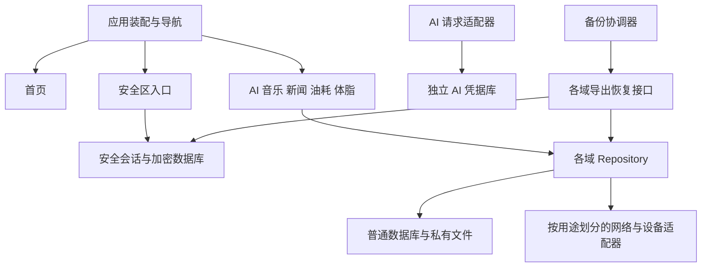

# ptoolbox 技术设计文档

版本：0.3；状态：实施设计，尚未完成 Android 工程验证。

完整页面与 Demo 交互规格见[总体详细设计（含 Demo 设计）](DETAILED_DESIGN.md)。本文定义工程架构、模块接口、存储事务、并发控制、加密边界、异常恢复与发布验证。文中的 Kotlin 和 SQL 为接口示意，不能视为已编译的工程代码。

范围变更：密码管理器已移除；安全笔记保留独立加密、笔记主口令及独立备份，以下安全域仅指笔记。

日期：2026-11-27。依据：[产品需求](REQUIREMENTS.md)与[手机交互原型](../demo/index.html)。

建议采用 Kotlin 原生 Android、Jetpack Compose 和按业务拆分的本地架构。独立加密安全笔记使用独立加密数据库；AI、音乐、油耗、体脂分别管理自己的数据与任务。无需自建业务服务器。新闻保持可替换的数据源接口，实际接入与排期仍待确定。

本设计用于指导工程实施，不代表加密、接口或设备兼容性已经通过验证。当前 ptoolbox 仅有文档与 HTML 原型，尚无 Android 工程。文中的资源上限、设备基线和性能预算均为建议值，需经验证后固定。

B 站与新闻的专项处理见 [采集设计](BILI_NEWS_DESIGN.md)；当前成果、限制及接手任务见 [项目交接](HANDOFF.md)。

## 技术决策

| 事项 | 建议方案 | 状态与原因 |
|---|---|---|
| 平台 | 原生 Android，Kotlin，Compose，Material 3 | 两个迁入项目均为 Kotlin 与 Compose，便于复用业务代码；HTML 只作为视觉参考 |
| 系统基线 | minSdk 26，compileSdk 与 targetSdk 暂以 36 建立验证基线 | 迁入项目最低均为 26；油耗 target 35，体脂 target 36。发布前按实际安装渠道和设备重新核对 |
| 界面状态 | ViewModel、StateFlow、协程、单向数据流 | 页面不直接操作文件、DAO、网络或播放器，遵循 Android 分层建议 [S1] |
| 导航 | Navigation 3 稳定版，四个顶层栈 | 新工程使用稳定接口，不追随 alpha；若迁入成本过高，可在 ADR 中决定继续 Navigation Compose [S2] |
| 数据 | 普通域 Room，偏好 DataStore；安全域独立 Room 与 SQLCipher | 分域便于恢复与迁移；普通数据库不存 API Key 或安全区内容 |
| 网络 | OkHttp、kotlinx.serialization，按用途独立 client | AI 自定义目标与 B 站、新闻不能共享鉴权和全局拦截器 |
| 音乐 | Media3 ExoPlayer、MediaSessionService、MediaController | 播放生命周期脱离页面，支持后台和系统控制 [S3] |
| 依赖注入 | 初期显式构造 AppContainer，业务接口注入 | 不把 DI 框架作为第一阶段依赖；不得通过全局 service locator 使任意模块取得安全区实例 |
| 加密 | 成熟实现，口令派生与数据密钥分离；见安全区设计 | Argon2id 实现及 SQLCipher/Tink 版本需通过兼容性、许可与安全检查后锁定 |
| 服务端 | 不自建账户、代理或下载服务器 | API Key 留在手机，AI 直连所配服务商；不默认引入第三方 B 站解析服务 |

版本统一写入 Gradle version catalog 并锁定，禁止动态版本。JDK、AGP、Kotlin、KSP 与 Compose 的组合在建工程时以实际兼容性为准，不机械复制旧工程的构建文件。

## 架构原则与取舍

总体取向：**按业务模块拆分的单体架构、明确的数据访问边界、按需增加进程隔离**。这个规模的个人 App，先把模块边界和恢复机制做好，比引入动态插件系统更有价值。首版模块随 APK 编译，不做运行时下载代码的插件方案。

各项能力存在取舍：进程越多，内存与跨进程通信成本越高；加密越强，解锁与处理成本越高。因此按风险分配复杂度，不对所有模块套用同一强度的机制。

| 目标 | 原则 | 在本文的落实 |
|---|---|---|
| 扩展性 | 采用 feature 业务模块、core 通用能力和各域适配器三层角色（适配器可落在对应 feature 内，不必单独建 Gradle 层）；页面只依赖用例或 Repository 接口，不直接调用数据库与网络；新增服务商、新闻源或秤协议通过新增适配器实现，不改业务代码 | 「模块与依赖」「AI 角色与会话」「B 站音频缓存」「新闻」 |
| 隔离性 | 代码、数据、任务、安全四类边界分别设计；各模块不访问其他模块的 DAO、文件目录或内部实现；core 只放通用能力，不演变为所有业务共享的大仓库 | 「安全边界」「数据模型与文件布局」「网络与资源预算实施」 |
| 安全性 | 权限与数据能力尽量小；附件、PDF、RSS、链接和备份按不可信输入处理，限制大小、解析成本、跳转与输出；组件默认不导出，日志不记录正文、凭据和带签名 URL | 「独立加密安全笔记」「AI 凭据保护」「权限与后台任务」 |
| 高性能 | 按需加载、流式处理、有界并发；不为每个字符触发重组与落盘；一个播放器实例共享媒体会话；不把整个文件读进内存 | 「网络与资源预算实施」「音乐播放与本地导入」 |
| 可靠性 | 把"中断后怎么办"作为接口的一部分；长期操作明确任务归属、重试后果、中断恢复与冲突优先级 | 「关键服务接口与竞态控制」「恢复协议与启动修复细则」 |

代码与数据边界采用 Gradle 模块、`internal` 可见性、窄接口和依赖规则检查，防止开发中误用内部能力；数据边界采用分域数据库、私有文件目录和独立凭据，缩小错误删除与恢复的影响范围。同一 APK 的普通多进程通常仍共享 UID，不能靠它保证安全笔记无法被联网代码读取；Android 应用沙箱建立在 UID 边界上 [S16]。本期保持单 APK 内可审计的逻辑隔离；若要求系统强制断网，采用独立包名、无 INTERNET 权限的笔记应用，工具箱只负责打开而不获取正文，拆包条件与代价见「安全边界」。

不可信输入按统一入口处理：附件、PDF、RSS、分享链接与备份在进入业务前完成格式校验、大小与解析成本限制、跳转次数约束和输出清理，不因来源是可信服务而跳过校验 [S17]。组件默认不导出，必要入口逐项校验调用方。

性能验收在正式构建和目标手机上测量冷启动、卡顿、峰值内存与耗电，使用 Benchmark 与系统跟踪定位瓶颈，再决定是否增加缓存或拆分进程；未测量前不把本文的调度数值当作性能结论 [S18]。

长期操作以四个问题定义接口契约：谁拥有任务、页面退出后是否继续；是否可重试、重试会不会重复计费或产生重复记录；文件与数据库更新之间中断后如何恢复；删除、恢复与运行中任务冲突时谁先停止。B 站下载只有校验完成才标记可播放；AI 重启后标记中断而不自动重发；恢复某一数据域前先冻结该域写入。

当前优先落实模块依赖检查、分域存储、适配器接口、任务状态机和故障恢复测试。进程拆分依据实际风险与性能测量再决定；安全笔记若要求系统强制断网，则直接采用独立应用边界，不在单 APK 内承诺该强度。

## 模块与依赖

```text
app                         应用装配、导航、权限、主题、分享入口
core:model                  UUID、时间、单位、可展示错误
core:ui                     主题、组件、无障碍与屏幕适配
core:storage                非敏感文件管理、原子发布、配额
core:network                TLS、取消、目标校验；不持有业务密钥
core:credentials            仅供 AI 使用的设备保护凭据
core:backup                 流式加密包与按域恢复协调
feature:home                工具入口、导航排序
feature:notes               独立加密安全笔记、会话、专用存储与加密
feature:ai                  角色、会话、多模态、协议适配
feature:music               曲库、歌单、歌词、播放与缓存
feature:fuel                车辆、加油、计算、CSV
feature:scale               BLE、成员、测量、算法
feature:news                演示数据；后续接入数据源
```

不为每个简单 CRUD 再建立一套独立 domain/data/api Gradle 工程。满箱算法、体脂计算、LRC 解析等纯逻辑用包或小型纯 Kotlin 模块隔离，避免模块数量本身成为负担。



app 负责装配，但不持有安全区的明文条目或长期解密密钥。业务域之间不直接查询对方 DAO；首页只取得普通模块概要及“安全区已锁定”等非敏感状态。

### 安全边界

Gradle 模块和不同数据库属于工程边界，同一 APK 内通常仍共享应用权限与 UID。只把安全区放在另一个普通进程，也不能宣称它没有网络权限或与同 UID 代码完全隔离。Android 应用隔离的基础是 UID 与系统沙箱 [S4]。

本期在单 APK 中实施可审计的逻辑隔离：安全区不依赖网络模块、无联网代码、无对外明文接口；AI 无法注入安全区 Repository；使用依赖检查、日志检查和网络测试约束。若要求操作系统强制禁止安全区联网，应另立独立包名、无 INTERNET 权限的安全应用方案，再评估与工具箱的交互；不能靠当前架构声称已满足该强度。

## 页面与操作状态

默认底部导航为首页、音乐、新闻、AI。DataStore 保存合法的四项排列，非法或缺项回退默认顺序。每个顶层导航保留自身返回栈和滚动位置，排序不销毁页面。

安全区采用独立且不对外导出的 SecureNotesActivity，便于设置安全窗口标志、遮蔽任务预览及明确锁定生命周期。Activity 分离用于管理页面与密钥生命周期，不作为 UID 隔离宣传。进入后台或返回普通模块即锁定，普通页面的状态恢复不能恢复解锁状态。

普通页面使用稳定记录 ID 恢复选择与滚动；草稿按会话保存。安全字段禁止写入 SavedStateHandle、rememberSaveable、Bundle、通知、分析日志或崩溃转储。安全区退后台先遮蔽再清理，不能等带延迟的应用生命周期事件才开始隐藏。

音乐迷你播放条、会话入口、空状态和错误恢复可作为现有功能的操作完善项；上一轮提出的其他附加功能不因技术设计自动重新纳入需求。

## 数据模型与文件布局

每个域独立数据库版本及 schema，所有非临时数据库导出 schema 并提供升级迁移；禁止 fallbackToDestructiveMigration。跨域不建立数据库外键。

| 数据域 | 主要实体与约束 |
|---|---|
| 安全区 | SecureNote、Category；全部业务字段位于加密库，UUID 为记录标识 |
| AI | Role、RoleRevision、Provider、ModelCapability、Conversation、Message、Generation、Attachment、MessageAttachment、RemoteFileRef；会话保存角色快照，生成记录保存请求配置快照 |
| 音乐 | Track、TrackSource、AudioAsset、ImportTask、DownloadTask、Playlist、PlaylistTrack、Lyrics、PlaybackSnapshot；歌单项以 playlistId/trackId 唯一、显式 position 排序 |
| 油耗 | Vehicle、FuelRecord、ImportBatch；记录含时间顺序、里程、单位、满箱标记、估算来源、漏记与异常状态 |
| 体脂 | Member、Measurement、MetricValue、MeasurementInput、DeviceProfile；测量保存成员资料快照与算法版本，指标值可空，来源与不可用原因单独存储 |
| 新闻 | 当前仅 FakeNewsRepository；Source、Article 等为后续候选模型，不提前落实网络抓取 |

```text
databases/ai.db, music.db, fuel.db, scale.db
no_backup/notes/             加密安全库及受保护的密钥封装
no_backup/credentials/       AI 凭据密文
files/ai/{attachmentId}/     原附件、派生文件和页码映射
files/music/audio/           用户明确保留的完整音频
files/music/lyrics/          LRC、文本歌词与解析版本
files/restore/{operationId}/ 可恢复的暂存代；敏感内容只能加密暂存
cache/                      可重建的缩略图与未完成临时文件
```

音频完整副本不放普通 LRU 缓存，不能被清理缓存顺带移除。应用私有目录不等于密码学加密；普通域沿用需求中的保护等级，不宣传为安全笔记同等级保护。

文件先写临时对象并校验，再原子发布；数据库记录 PREPARING/READY/MISSING，启动时回收孤立临时对象、核对文件引用，避免文件与数据库更新中断后静默失配。导入去重以内容散列辅助，但散列不能替代加密认证。

金额使用整数分，升数、价格和里程使用明确精度的十进制或缩放整数，界面最后一步舍入。测量保留原始协议精度。时间使用 UTC 瞬时值加原时区；仅含日期的旧加油记录保留其日期语义，不伪造测量时刻。

## 独立加密安全笔记

### 密钥结构

建议使用随机 256 位数据密钥打开安全域 SQLCipher 数据库；笔记主口令不直接作为数据库口令。笔记主口令经 Argon2id 派生 KEK，以 AES-256-GCM 封装数据密钥。SQLCipher 采用其成熟的页加密与认证实现，不自行设计数据库加密模式；SQLCipher 与 Room 的集成需固定受支持的组合 [S5]。

```text
笔记主口令 + 随机盐 + 已版本化 Argon2id 参数
    -> 口令保护密钥 KEK
    -> AES-GCM 解封装 NotesDEK
    -> 解锁专用加密数据库

系统生物识别 + 认证绑定的 Android Keystore 密钥
    -> 解封装另一份 NotesDEK
    -> 同一安全会话
```

Argon2id 使用受维护实现，先以 64 MiB、3 次迭代、4 lanes、16 字节随机盐、32 字节输出作为设备验证候选；这是待测候选，不是已完成的移动性能结论。内存与时间成本参考 RFC 9106，并以目标低端机实测确定，不在失败时静默减弱 [S6]。设置口令支持空格、Unicode 与长短语，不做 trim、静默规范化或截断；初始规则建议至少 12 个字符并拒绝常见弱口令，最终规则随安全评审固定。

GCM nonce 由安全随机源生成、每次封装重新取值，不复用固定 IV。封装认证同时绑定格式版本、KDF 参数、盐和库标识。封装大小及 KDF 参数在派生前做边界校验，禁止外部输入要求无限内存。只有认证通过后才能使用数据密钥。

生物识别使用 AndroidX Biometric 的 CryptoObject 驱动 Keystore 加密操作，不能仅依据认证成功回调切换 Boolean。Keystore 支持对密钥使用施加认证约束，但不代表数据库打开后明文从不进入应用内存 [S7]。新登记生物识别、密钥失效或能力不足时撤销快捷解锁并回退笔记主口令。

修改笔记主口令时重封装数据密钥，原子替换封装文件并递增会话版本；失败继续使用旧封装，成功删除旧生物识别封装及关联 key alias。历史备份及攻击者已复制的旧快照不会因此自动失效，不承诺检测所有文件系统回滚。

### 会话与锁定

NotesSessionManager 管理 LOCKED、UNLOCKING、UNLOCKED、LOCKING，成功解锁创建带 generation 的会话令牌。Repository 查询、写入及 UI 更新前检查令牌；锁定使 generation 失效、取消作用域、阻止新读取、关闭数据库并清理可释放缓冲区。排队中的旧结果也必须被拒绝，不能只在页面入口验证。

笔记主口令和密钥尽可能用可覆盖数组，避免应用层复制；JVM、Compose 和第三方库存在不可控副本，不承诺完全清零堆内存。限制解锁期间加载量，不把全库明文写入全局 StateFlow。

解锁失败计数保存在安全区外围的私有非敏感状态，后台与重启不清零；等待阶梯先建议第 5 次开始 30 秒、后续递增至 15 分钟上限。离线复制后的猜测主要依赖强口令与 KDF 成本，应用计数不能代替它们。

使用 FLAG_SECURE、敏感输入不参与自动填充与个性化学习、隐藏最近任务预览。外部输入法、被控制的系统及外部拍照不属于本地 UI 能完全阻止的范围。

剪贴板设置敏感标记与一次性归属 token，30 秒清理前校验仍为本次副本。后台定时器可能被系统暂停，不宣传严格到秒保证；下次可执行时再次检查，不能因清理旧副本删除用户新复制的内容。

### 实施门槛

发布前检查加密数据库主文件、WAL、journal、临时文件、日志与状态快照；用可检索的虚构秘密验证没有明文残留。对损坏密文、错误口令、锁定竞态、生物识别变更和笔记主口令变更中断做故障测试。认证失败拒绝访问并保留原文件，不自动重置。

安全库的原生依赖必须验证目标 ABI、16 KB 系统内存页支持和许可证。SQLCipher 的原生页对齐适配有官方说明，但不能用文档存在代替最终 APK 实机验证 [S8]。

## AI 角色与会话

角色配置包括名称、系统提示词、默认 Provider/Model 引用和可选参数。保存生成 RoleRevision；创建会话复制快照。选择角色改变新会话默认值，明确显示“新建会话使用此角色”；要修改当前会话需单独操作并说明只作用于后续消息。删除角色不删会话。

Provider 保存协议类型、规范化 HTTPS 目标和非敏感配置；凭据只存 secretRef。ModelCapability 记录图像、原生 PDF、上传、流式、参数及大小限制，证据标记 VERIFIED、USER_CONFIGURED 或 UNKNOWN。不能以模型名字推断能力。

一期候选为 OpenAI 兼容的图文协议，实际服务商必须使用测试样本验证；“兼容”不代表原生 PDF、文件上传、全部参数或流式结构都相同。当前尚未指定真实 Provider，不能把某一协议选型写成已完成联调。

```kotlin
interface AiProviderAdapter {
    suspend fun validate(plan: RequestPlan): ValidationResult
    fun generate(plan: RequestPlan): Flow<GenerationEvent>
    suspend fun cancel(generationId: String)
}
// GenerationEvent: Started / TextDelta / Usage / Completed / Failed
```

RequestPlan 在用户确认后固定角色快照、模型、上下文消息 ID、附件变体、页范围、参数及请求目标。实际密钥仅在请求边界按 secretRef 读取，不进入可序列化 RequestPlan 或日志。正文、Base64 和 HTTP 错误响应不输出到日志。

同一会话仅一个进行中的 Generation，通过数据库状态条件更新和会话级 Mutex 防止重复提交；UI 按钮禁用只是辅助手段。不同会话最多并发两个请求作为初始预算。用户停止必须取消底层 Call，保留已收到部分文本且标记 STOPPED；进程重启将遗留运行态改为 INTERRUPTED，不自动重发。

SSE 通过协议适配器增量解码，处理 UTF-8 跨块、事件分隔、终止与网络中断。界面更新与落盘批量节流，建议每 0.5 秒或 2 KB 持久化一次、终态立即落盘；异常退出可能损失最后一个批次，需在测试中量化。消息与生成记录分离，重试不再次写入同一用户消息，供应商不保证幂等时不自动重试可能已计费的请求。

上下文组装仅按当前会话选定消息与回复版本，清除上下文保存一个边界而不删历史。估算 token 不冒充服务商精确计数；超限请求让用户选择历史或附件页，禁止静默截断及自动摘要替换全文。

### AI 凭据保护

自动请求使用的凭据密文由独立 Keystore 密钥保护，不共用 NotesDEK。若要求自动使用的同时禁止无认证查看和导出，仅在 UI 增加认证不构成密码学强制隔离：能发出请求的同 UID 代码最终也能取得凭据。

本期把查看和导出的系统认证作为产品访问规则，并在威胁模型中声明上述限制；若需要密码学上每次使用都需用户认证，则应让全部 AI 调用经过认证绑定密钥，改变当前 A10 的便利性要求。两种保护强度不能同时无条件承诺。

## AI 图片与文档

附件处理采用状态机 SELECTED、COPYING、VALIDATING、PREPARING、READY、FAILED。通过系统选择器读取 content URI，复制到所属会话私有目录后才标 READY；URI 不当作文件路径拼接。只有点击发送且请求计划确定后允许远程上传。系统文档选择器可能展示第三方云盘，选择远程文件时其提供方可能联网，不把这种行为宣称为应用可控制的“完全离线选择” [S9]。

| 输入 | 一期路径 | 兼容与失败规则 |
|---|---|---|
| JPEG/PNG/WebP | 边界解码、方向修正、去元数据、可预览压缩，发送真实图像内容 | 超大像素在全量解码前拒绝；不静默裁剪 |
| TXT/Markdown | 严格 UTF-8 解码，转成带文件名与行区间的文本片段 | 保留映射，字符解码失败提示转换；不加载 Markdown 外链图片 |
| PDF 文本页 | 按选择页提取正文及页码映射，显示实际发送路径 | 表格、图片和多栏可能丢失结构，明确提示 |
| 扫描 PDF | 原生 PDF 适配器或受限逐页渲染图像 | 两者均不可用则拒绝，不将空字符串当成功；OCR 后续 |
| 加密 PDF | 一期拒绝 | 用户另行提供已解锁副本 |

Android PdfRenderer 的页面文字提取接口 getTextContents 在 API 35 加入，不能据此假设 minSdk 26 上也可直接使用 [S10]。PdfTextExtractor 单独抽象：API 可用时使用系统实现；旧系统需验证维护中的第三方实现，或明确改走渲染图像。旧系统没有文本提取时仍应能通过经验证的图像模型完成选定 PDF 页问答，而非静默放弃文档支持。

建议初始约束：每请求最多 5 个附件、单文件 20 MiB、合计原始文件 40 MiB、PDF 读取页数最多 20 页、图像长边目标不超过 2048 px、拒绝超过 40 MP 的原始图片，解析并发为 1。图像编码体积、Base64 膨胀、页图总量与模型上下文仍须单独预算；任一 Provider 更严格时取较小值。这些参数需要以实际机型、文档质量与服务商上限验证后固定。

解析器不得执行文档脚本或访问外链；以页为单位限制内存并允许取消，异常文件在解析前后均设资源上限。PDF 原生上传和渲染页图是不同请求计划，不将其中一个的能力标志复用于另一个。

## 音乐播放与本地导入

PlaybackService 持有唯一 ExoPlayer 与 MediaSession；页面及迷你播放条通过 MediaController 观察和控制同一会话。MediaSessionService 是独立 Service，不要求为此额外声明进程；依据官方方案实现后台播放 [S3]。

Track 与 AudioAsset 分离：曲目拥有来源、名称、作者及歌单关系；音频资产有实际文件、格式、散列、大小与可播放状态。播放只依赖 READY 的本地资产，一期不因资源缺失偷偷切成网络流播放。

本地导入通过文档选择器读取并复制私有持久目录，提取音频元数据后验证解码能力，原子生成资产。文件名相同不自动判重复，散列相同则复用资产；取消和空间不足删除临时文件，不删除用户原文件。无需整库媒体扫描或所有文件访问权限。

播放队列与歌单分离：从歌单播放建立队列快照，歌单后续编辑不使当前索引错位。顺序、单曲、随机保存为播放器状态；随机保存当前排列与历史，上一首返回实际上一曲。恢复曲目、队列与进度，但进程终止后不自行播放。

处理音频焦点、暂时打断、耳机拔出和播放错误。播放进度按约 5 秒、暂停、切歌、停止时保存，拖动期间避免持久化风暴。Android 前台服务、通知与音频焦点需在目标系统逐项验证，不以关闭省电限制作为正常使用前提。

## B 站音频缓存

链接解析与下载从播放器分离。核心接口如下，界面不依赖站点的临时 URL 或签名字段：

```kotlin
interface BiliSourceResolver {
    suspend fun resolve(link: String): VideoPreview
    suspend fun resolveAudio(videoId: String, partId: String): AudioResource
}
```

先在开发环境用 yt-dlp 验证样本，再做原生轻量适配器的可行性验证；不把 Python 运行时或第三方收费解析服务直接嵌入 App。若原生路线成本过高，再测量 Android 封装方案。当前没有经测试的端点、签名方案和样本，B 站解析是交付风险项；开放平台存在不代表已提供适用于本需求的通用下载能力。

流程：提取分享文本地址 → 限定入口域名 → 有限解析短链接 → 显示视频与分 P → 用户确认 → 取得音轨 → 下载临时对象 → 验证长度、容器与可播放性 → 发布资产。稳定去重键为视频 ID 与分 P ID，不能使用会过期的下载 URL 去重。

短链接和媒体重定向逐跳校验，限制次数、协议、最终域名与私网目标；媒体 CDN 域名集合由真实响应验证后配置，不能使用无限域名放行。AI 凭据、日志拦截器或通用认证头绝不附加到媒体请求。签名 URL 的查询串视为敏感临时信息，不记日志。

任务状态为 QUEUED、RESOLVING、DOWNLOADING、VERIFYING、READY、PAUSED、FAILED、CANCELED。断点续传校验资源身份、Range 响应及 ETag/长度等条件；服务端忽略 Range 返回全量时重新开始，不能追加到旧文件。过期后重解析但不无限重试。

建议优先评估 Media3 DownloadManager/DownloadService：它提供离线下载任务机制 [S11]，但源地址刷新和站点解析仍由本项目适配；若不支持目标音轨形态，再使用有独立持久队列的文件下载器，并记录替换理由。

不把长下载一律丢给 WorkManager 就宣称无限后台执行。Android 16 长时 Worker 可能消耗任务配额，需要按用户发起的传输与前台服务限制选择机制并实测 [S12]。WorkManager 只承担可延迟维护和允许重试的短任务，不自动重放 AI 请求。

## 歌单与歌词

歌单使用稳定 trackId，添加、移除、重排在一个数据库事务中；删除歌单只删关联。移出歌单、移除曲目、删除资产是不同命令，资产有引用检查，不能删坏其他曲目。

Lyrics 记录 trackId、语言、来源、格式、偏移、原始文件和解析版本。LRC 支持同一行多时间戳、毫秒精度和 offset，先排序，再用当前播放时间二分定位歌词；TXT 仅静态显示。未知标签忽略但保留原文件，乱码或空解析不覆盖已有歌词。

歌词高亮只在展示期间按约 200 ms 更新；手动滚动后暂停自动跟随，提供“回到当前句”，点击带时间的歌词通过 Player.seekTo 跳转。切歌取消旧歌词订阅，不能让旧文件导入结果错误覆盖新曲目。网络自动搜词尚未纳入实施；示例歌词不可作为正式内容发布。

## 新闻

目前仅确定要有新闻模块和示例样式，未决定来源。当前提供 FakeNewsRepository 与明确标注的样例文章，用于列表、分类和详情的 UI 测试；不启动真实轮询、抓站或自动摘要。

后续根据选定来源实现 NewsSourceAdapter，再确定正文、链接、缓存期限、刷新周期和失败提示。若使用 RSS/Atom，需明确 XML 外部实体禁用与资源限制；若使用站点 HTML，不默认执行脚本或启用 JavaScript bridge。优先原生正文或系统浏览器打开链接，不在装有安全数据的应用里执行任意网页代码。

新闻不得读取音乐历史或 AI 会话做隐式推荐。新闻引入备份时先确认是备份订阅配置、阅读状态还是文章副本，未确定前不扩张 B1 的恢复范围。

## 油耗迁入

本机源码位于 ../../carassistant/android。已核对 FuelMath、MetricsCalculator、FuelRepository 与 AppDatabase，尚未在本轮编译或重跑旧测试。

| 现有行为 | 与当前需求的差异 | 迁入处理 |
|---|---|---|
| FuelMath 按时间和 ID 排序，满箱切分，阈值 1–25 L/100 km | 阈值是旧项目策略，不应误称对所有车辆已验证 | 保留样本与测试，将阈值显式配置并核对新需求 |
| MetricsCalculator 累计距离为最大里程减最小里程 | F5 要求有效区间累计距离 | 新字段按有效区间之和，旧口径只在迁移报告中注明 |
| 续航按油箱容量或上次加油量估计 | 当前需求要求有可靠依据，不能当实时剩余续航 | 展示明确的整箱估算口径，缺失依据不展示剩余里程 |
| CSV 按同车、日期、里程去重 | 相同日期里程但升数金额不同属于冲突 | 区分完全重复与候选冲突，导入预览后事务提交 |
| fallbackToDestructiveMigration | 升级可能删除现有记录 | 不迁入，采用显式 Room Migration |
| release 使用 debug 签名 | 不适合承载正式敏感笔记数据的发布流程 | 新包使用独立持久 release 签名，密钥不入库 |

迁入时优先提取纯算法、CSV 解码与测试向量，重新实现 Repository 约束。新旧包名不能直接读取对方私有库，用户通过旧应用导出再在新应用导入；禁止假设装了新 APK 就能自动读到旧记录。

## 体脂迁入

本机源码位于 ../../smart-body-scale-android。已核对 BLE 客户端、Room 实体、ScaleRepository、BodyAlgorithm 及 WebDavManager 的备份结构；支持 UUID 列表不等于每款设备都已经实机验证。

关键差异：BodyAlgorithm 无阻抗时把部分体成分返回 0；ScaleRepository 无成员时可能使用首个成员身高或默认 170 cm 计算 BMI；现有实体未包含当前需求要求的全部算法输入快照，且未见基础代谢字段。迁入必须改为值可空并标来源，无确定身高则 BMI 不可用；不为了展示八项指标补造数据。

S2 已明确不做无阻抗估算，与原算法没有该回退的事实一致。保留实测体重及有效资料计算的 BMI；其他指标只有存在已验证算法时才可计算。自定义体成分公式不能因已有代码便被认定为医学验证算法。

BLE 拆成扫描、连接、协议识别、报文解析、会话归并、成员确认六部分；以设备标识与测量 sessionId 去重，多次广播更新同次测量。候选成员匹配只给建议，不确定则用户确认；测量与成员参考体重在同一事务中更新。

Android 12 及以后按需申请 SCAN/CONNECT，旧版本按系统要求申请位置。neverForLocation 可能过滤部分广播，必须用目标秤实测，不能仅为少申请权限就无条件设置 [S13]。

现有 WebDavManager 已包含 version=1 的成员与测量 JSON 备份结构，原需求末节“原项目没有导出功能”需要据此重新核对；尚不能等同于已有用户可用的本地导出。可复用序列化字段，补一个本地导出入口完成迁移，不将 WebDAV 联网和 Health Connect 同步直接带入新项目，也不复制多余权限。

旧记录缺失原始输入时标记 LEGACY/UNKNOWN，保留旧值而不伪造完整来源；显式重算才生成新算法结果。

## 备份与恢复

普通域和安全域统一使用版本化加密包，但各自独立选择和恢复。一期只支持单域恢复，降低数据库、文件和外部凭据的跨域原子性复杂度；多个域可依次恢复，每一步明确结果。

大音频与附件不能整个读入内存。候选使用 Tink Streaming AEAD 的成熟文件加密实现，随机创建备份 keyset，再用备份口令派生密钥封装 keyset；不自行按固定 nonce 把文件分块 GCM 加密。Tink 提供 Java 流式认证加密能力 [S14]。

包头只包含 magic、格式版本、KDF 参数、随机盐和密钥封装等必需信息，并纳入认证绑定；域清单、文件名、条数等放入加密内部。采用受限容器，检查条目路径、重复路径、展开大小、条数与总大小，防目录穿越和资源耗尽。只有完整认证与清单检查通过后才能进入提交阶段。

安全区备份不得把未经加密的明文导出文件落盘：解锁后以受控流写入加密目标，取消即终止；因后台或超时锁定时取消导出。文件目标由系统保存选择器确定，目标提供方可能是云盘，不能把用户显式选定云盘目标与应用自动云同步混为一谈。

恢复使用两个阶段：

1. 校验与准备：在暂存代解密、校验实体关系、附件与版本。安全区直接生成用新 NotesDEK 保护的新库，不落明文中间库。
2. 提交与恢复：暂停该域写入及任务，关闭连接，使用带 operationId 的恢复日志和代际目录，切换数据库与文件代后提交。启动时根据持久提交点完成或回退，旧代在恢复成功后再清理。

普通文件系统的多文件 rename 不是一次原子事务，不能只写“原子恢复”便假设已经解决。恢复协调器必须定义崩溃恢复点；AI 恢复取消在途生成，音乐恢复先停止播放与下载，安全区恢复使所有旧会话失效。

系统自动备份与设备迁移明确排除全部业务私有数据和密钥材料，使用 allowBackup、旧版 backup rules、新版 dataExtractionRules 与实际设备验证，不仅设置一个开关就宣称所有厂商迁移路径都被阻止。应用提供手动加密备份，不依赖系统隐式复制安全库。

## 权限与后台任务

| 能力 | 权限与生命周期 |
|---|---|
| 联网 | INTERNET；AI、媒体、未来新闻按用途网关控制，无全局密钥头；安全区无网络依赖 |
| 文件与图片 | 系统文件或照片选择器，只读用户选定内容；不申请 MANAGE_EXTERNAL_STORAGE，不整库扫描 |
| BLE | 进入测量流程才申请必要权限；退出停止扫描和有限重连 |
| 音乐 | mediaPlayback 前台服务、系统媒体会话及所需声明；通知权限与媒体通知特殊行为按 OS 版本验证 |
| 下载 | 用户显式发起，有限重试、可取消、有进度；按系统版本选择合适传输机制 |
| 安全区 | 生物识别按需启用，安全窗口，敏感输入限制；无悬浮窗与无障碍服务 |
| 维护 | 可延迟清理使用短任务；不为了新闻示例或 AI 对话保活增加常驻服务 |

App 生命周期、播放 Service 生命周期和安全解锁生命周期独立：音乐后台播放不能使安全区继续保持解锁。

## 工程质量与验证

| 验证层 | 重点 |
|---|---|
| 纯逻辑 | 满箱样例与异常传播、角色快照、上下文选择、LRC 时间定位、金额精度、备份版本边界 |
| 数据集成 | Room migration、外键与唯一约束、CSV 冲突、曲目资产引用、按域恢复及故障回退 |
| 协议 | 本地假服务验证 SSE 碎片、取消、鉴权重定向、429、超时、附件能力不兼容；用真实服务商验证已知样本 |
| 安全 | 虚构秘密明文扫描、密文篡改、Keystore 失效、解锁锁定竞态、进程重建、release 配置与依赖检查 |
| 设备 | minSdk 机型、API 31/35/36、16 KB 页设备；耳机与来电、通知、BLE 广播秤与连接秤、低空间与断网 |
| 交互 | 返回位置、草稿保存、错误重试、触控与字体放大、TalkBack；密码解锁页不可被普通状态恢复绕过 |

初始性能目标用于测量而非承诺：基线机上普通首页冷启动目标 2 秒内；曲库 1000 首、AI 消息 10000 条、安全区 1000 条记录作为首轮样本；数据库分页与按需加载。KDF 解锁单独计时，不为普通启动指标削减密码保护成本。

正式包使用独立签名、关闭调试与明文网络、无日志正文拦截器；依赖校验和与可复现构建记录纳入发布检查。安全关键修改须代码评审并留存验证证据；未解决的明文泄露、认证绕过与数据丢失问题阻断发布。

## 实施顺序

| 阶段 | 可验收产物 | 进入下一阶段的条件 |
|---|---|---|
| 0 风险验证 | 真实 B 站音轨样本、AI 图文与 PDF 样本、安全库与备份样本、BLE 设备清单 | B 站适配可用或明确阻塞；AI 选定服务商；加密依赖通过兼容测试，不能以空接口算完成 |
| 1 工程骨架 | 可安装 Android APK、四导航、主题、普通数据库、DataStore、正式签名流程 | 返回栈、重启状态、最小权限、普通数据迁移测试可用 |
| 2 音乐闭环 | 本地添加、后台播放、歌单、歌词、可靠资产管理 | 断网重启仍可播放，系统控制与删除语义正确 |
| 3 数据迁入 | 油耗 CSV、体脂样本导出与导入、算法差异报告 | 样本与全量条数及关联核对通过，再替换旧应用 |
| 4 AI 闭环 | 多角色、多会话、图像与 PDF/文本问答、取消及失败恢复 | 请求范围可核对，兼容性按真实 Provider 验证 |
| 5 安全区交付 | 笔记主口令、生物识别、安全笔记、加密备份恢复 | K1—K10 与故障测试通过；验证前仅用虚构数据 |
| 6 整体验收 | 统一备份恢复、设备矩阵、交互与回归 | 明确已实现范围；新闻若未确定来源则继续标为样例 |

安全区的风险验证必须在阶段 0 开始，不能拖到最后才选加密方案；功能正式交付在隔离与恢复机制成熟后进行。阶段可根据实际优先级调整，不在未验证接口前承诺工期。

## 实施前仍需确定

1. 实际手机型号、Android 版本及是否有必须支持的旧设备，决定最低版本和性能预算。
2. 首个 AI 服务商、模型与可用测试账号，在不输出密钥的条件下验证图像、流式与 PDF 路径。
3. 两个旧应用是否有必须保留的数据，以及可用于实测的体脂秤型号。
4. B 站普通公开链接、短链接、多分 P 的可用样本；是否存在需要授权才能访问的内容。一期仍按无需登录设计。
5. 新闻真实来源与阅读方式；当前不影响其他模块开工。
6. 安全区是否接受单 APK 的逻辑隔离；若要求系统强制离线，需要重新评估独立安全应用。AI 凭据的自动使用与逐次认证强度也需明确。

上述待定项只阻塞相关能力验证；不阻塞工程骨架、本地音乐与纯算法迁移的准备。

## 工程实施契约

### 决策优先级与文档衔接

需求文档定义必须满足的行为；总体详细设计定义页面与业务流程；本文定义技术实现，B 站与新闻专项文档补充协议细节。无法同时满足时先记录差异，不通过偷偷删需求或降低安全等级解决。

统一以下实施口径：

- 本地音乐首版默认复制到私有持久目录；系统 URI 只用于导入读取，不作为唯一长期资产。这样避免第三方提供方撤权导致曲目不可用。未来若增加「仅引用」模式，需要另行定义失效和备份行为。总体详细设计中持久 URI 优先的描述调整为这一口径。
- 一期备份包按单个业务域导出和恢复；多个域依次操作，各自报告结果，不承诺跨域全有或全无。
- 阶段顺序以风险验证先行为原则，其余里程碑可调整。总体详细设计中的 P 阶段与本文数字阶段不作为两套固定排期。
- AI 会话内不提供角色切换编辑入口；首版角色修改影响新会话。前文所述「修改当前会话」仅是未来显式变更的约束，不增加当前范围。
- 新闻只实现样例 Repository；以下采集契约是来源确定后的实现准备，不自动启动后台抓取。

### 工程目录与依赖方向

```text
app/src/main/                 MainActivity、启动协调、AppContainer
core/model/                   错误、ID、时间、单位与纯数据类型
core/ui/                      Theme、组件、UiState、格式化
core/storage/                 FileStore、配额、文件发布
core/network/                 ClientFactory、连接策略、脱敏诊断
core/credentials/             AI SecretStore
core/backup/                  容器、加密流、恢复协调器
feature/<domain>/
  presentation/               Screen、ViewModel、UiState、Action
  domain/                     用例、纯算法、Repository 接口
  data/                       Room、文件、网络/设备实现、映射
feature/notes/                单独的存储与认证装配，不复用普通 DAO
schemas/<database>/           Room schema 历史
docs/adr/                     后续工程决策及验证记录
```

feature 可以依赖必要 core；core 不反向依赖 feature；feature 间通过 app 注入的窄接口协作。backup 定义 DomainBackupPort，由各域实现并由 app 注册，避免 backup 对所有 feature 形成反向依赖。安全域备份由认证后创建的短期端口执行，不允许核心容器长期保存明文读取能力。

构建依赖使用 version catalog、固定版本与依赖验证；原生库列出 ABI、来源、许可、16 KB 页兼容结果。配置由 debug/release 分离，正式签名材料从本机安全配置取得，不写在源码或文档。

### 页面状态、作用域与应用启动

普通页面 ViewModel 输出不可变 StateFlow，收集按页面生命周期进行；表单值和持久记录分开。保存请求返回提交结果后再发关闭页面动作，重组不重复保存。普通一次性提示允许丢弃，保存失败和需要用户处理的错误保存在 UiState，不能只发一次性事件。

| 作用域 | 所属工作 | 结束规则 |
|---|---|---|
| 页面/ViewModel | 查询展示、普通编辑、页面局部解析 | 页面退出取消；持久任务不归它所有 |
| AI 生成协调器 | 请求、流解析、部分结果落盘 | 用户停止、进程结束或模块关闭；切页不串会话 |
| 媒体服务 | Player、队列、系统媒体会话 | 由播放与系统服务规则管理 |
| 下载协调器 | 任务认领、传输、校验 | 可暂停取消；进程重启靠数据库恢复 |
| NotesSession | 安全查询、写入和导出 | 锁定立即撤销所有新操作权限 |
| RestoreSession | 暂存验证、域冻结和提交 | 完成/失败后释放；启动恢复日志接管中断 |

启动步骤：读取非敏感偏好 → 检查恢复提交日志 → 对受影响域执行完成/回退 → 打开该域数据库 → 迁移 → 修复过期运行态 → 展示页面。首页不必等待无关媒体扫描或联网；恢复未完成的域显示受控状态，不能同时接受写入。

### 统一错误与取消

```kotlin
data class AppError(
    val code: ErrorCode,
    val operationId: String?,
    val retry: RetryPolicy,
    val userMessageKey: String
)
enum class RetryPolicy { NEVER, USER_ACTION, SAFE_BACKGROUND }
// ErrorCode 按域定义，不能将原始 HTTP body 或秘密作为 message。
```

| 错误类别 | 示例 | 处理 |
|---|---|---|
| 输入/能力 | 链接非法、模型不支持图片 | 不请求网络；定位字段或附件 |
| 认证 | Key 无效、笔记主口令错误 | 不自动重试；按所属域重新认证 |
| 临时网络 | DNS、超时、429、5xx | 下载/新闻有限退避；AI 是否已提交不明时由用户决定 |
| 本地资源 | 磁盘不足、URI 不可读 | 保留原记录；清理本次暂存，提示操作 |
| 完整性 | 备份认证失败、密文损坏 | 拒绝发布和覆盖，保留原文件 |
| 状态冲突 | 已删除、版本变化、域正在恢复 | 重新读取或等待，不用旧状态盲写 |
| 取消 | 用户停止、域冻结 | 作为取消终态，不伪装为异常或成功 |

协程取消应继续传播 CancellationException；finally 释放文件、Call、PDF 页面和 BLE 资源。不在 catch-all 中把取消变成重试。退避采用有限指数等待和随机抖动，遵循可用的 Retry-After；重试次数和下次时间持久化，防止每次重启重新获得无限次数。

## 数据库约束与事务实施

### 索引、版本与并发更新

| 数据表/关系 | 必要约束与索引 |
|---|---|
| message | `(conversationId, sequence)` 唯一；列表按 sequence 分页 |
| generation | `userMessageId`、conversationId 和 status 索引；活动生成受条件更新保护 |
| message_attachment | `(messageId, attachmentId)` 唯一；引用删除事务化 |
| role_revision | `(roleId, revisionNumber)` 唯一；会话保存独立快照 |
| track_source | B 站 `(kind, videoId, partId)` 唯一；本地导入按散列核对资产 |
| playlist_track | `(playlistId, trackId)` 唯一；position 排序并以 ID 稳定打破平局 |
| download_task | sourceId、state、nextAttemptAt 索引；每来源最多一个活动任务 |
| fuel_record | `(vehicleId, businessDate, id)` 排序索引；相同日期里程不直接判完全重复 |
| measurement | `(memberId, measuredAt, id)`；协议 sessionId 按设备范围去重 |

活动任务可使用独立 active_operation 表，以业务 ownerKey 为主键保存 operationId，借助唯一约束实现互斥，不依赖 UI 或仅进程内 Mutex。认领、业务记录和任务写入在同域事务内完成。任务结束释放认领；启动先检查对应任务再修复陈旧认领，不按任意超时删除仍在工作的所有者。

可编辑普通记录带 revision。更新使用 `WHERE id = :id AND revision = :expected`，影响行数为 0 时返回冲突，不覆盖其他编辑。所有 DAO 异步访问，查询 Flow 与写入 suspend 的分工依据 [S15]。

歌单重排在单事务中更新全部 position；如采用 position 唯一约束，先使用无冲突暂存位置再赋最终值。删除前重新计算引用，不能使用页面打开时缓存的引用数。

### 文件发布与恢复扫描

文件和数据库分两阶段协调：

1. 创建 PREPARING 元数据与 operationId，写入同一文件系统的暂存对象，限制总字节数。
2. 关闭输出并按实现需要同步，校验散列、格式和可读性，发布为不变的最终文件名。
3. 数据库事务将引用更新到最终对象并设 READY，记录大小/格式/散列。
4. 提交失败时最终文件暂为孤儿；下次扫描根据 operationId 与引用进行清理或补偿。

播放和读取入口同时核对 READY 与文件实际存在。暂存下载默认保存在私有持久 staging 中，以支持重启续传；cache 只放可丢失缩略图等。若下载器使用 cache 暂存，任务恢复必须能处理被系统清除并重新开始，不能保证断点仍在。

仅原子移动一个文件不等于跨库提交，也不自动保证断电耐久性。恢复测试覆盖移动后、数据库提交前等中断点。孤儿清理采用宽限期并排除正在写入对象；不以文件名相似删除外部文件。

### 迁移规则

首次建库和升级分别测试；旧 schema 到当前版本使用导出的 Room schema 作为验证基线。迁移先检查空间与版本支持，失败保持旧库并展示恢复说明，不回退清库。涉及文件布局改变时先保持旧引用可读，迁移成功后再删除旧文件。

导入使用 ImportBatch：保存格式版本、来源、hash、总条数、成功/重复/冲突/失败计数；先预览再事务提交。同一文件重导不重复插入，内容冲突显式选择。体脂旧记录缺少资料时保留 LEGACY 标记，不以当前成员资料反填历史输入。

## 关键服务接口与竞态控制

以下接口描述职责和失败语义，类型在建工程时落实。接口不暴露 DAO 或直接的秘密字节数组给普通页面。

### 安全域接口

```kotlin
interface NotesController {
    val state: StateFlow<NotesState>
    suspend fun unlock(input: MasterPasswordInput): UnlockResult
    suspend fun lock(reason: LockReason)
}
interface NotesCommands {
    suspend fun save(token: NotesSessionToken, draft: SecureNoteDraft): SaveResult
    suspend fun delete(token: NotesSessionToken, id: String): DeleteResult
}
```

token 是进程内不透明能力，不可序列化，也不允许从 Intent 构造。安全域操作排队时和执行前校验 generation；读结果发布前再次检查。锁定过程先同步拒绝新操作并遮蔽 UI，再取消和等待受控在途写事务结束/回滚后关库。已开始的事务可能在锁定边界完成提交，但不得在锁定后把明文结果发布到界面。

生物识别弹窗需要单独识别生命周期：启动认证前不建立解锁会话；系统弹窗结束后必须同时确认认证操作成功、Activity 仍前台且请求 generation 未撤销。不能为了避免弹窗引起的生命周期变化，全局跳过后台锁定。旋转或重建后保守保持锁定。

密钥封装文件使用版本化格式：formatVersion、notesId、KDF 类型与参数、salt、nonce、ciphertext/tag；字节序与编码固定，AAD 采用确定性编码。生成新封装时重新取 salt/nonce；先验证新封装能解开同一 DEK，再在恢复日志保护下替换有效指针。旧封装清理在提交完成后执行；不承诺使攻击者已持有副本失效。

### AI 请求与附件接口

```kotlin
interface GenerationCoordinator {
    suspend fun submit(conversationId: String, draftId: String): SubmitResult
    suspend fun stop(generationId: String)
}
interface AttachmentProcessor {
    suspend fun prepare(id: String, selection: PageSelection?): PreparedAttachment
}
interface RequestPlanner {
    suspend fun build(conversationId: String, draftId: String): PlanResult
}
```

submit 使用 draftId 作为本地幂等键，事务创建用户消息、附件关联、Generation 和活动认领，成功后发请求。RequestPlan 记录内容引用与不可变版本；附件内容变更需新 attachmentId，不能在发送途中覆盖。远端文件按 Provider+凭据配置版本隔离，换 Key 或目标后不得复用另一账户的 remoteId。

收到流事件后通过 generationId 与状态条件写入，停止后的迟到 delta 丢弃；终态只允许首次成功转换者写入。部分文本按序号累积，重试创建新的 Generation 并关联同一用户消息，保留旧失败或中断版本。当前展示版本由明确引用决定，不能将多个尝试拼成一条回复。

移除附件先释放草稿引用；文件已关联发送消息时保留消息引用。删除会话取消生成、删除关联，再由引用清理器删除本地孤儿；远端删除通过独立补偿记录执行，其失败不能假装远端已删除。文件大小上限同时约束流读取、提取文本、派生图片及请求序列化，避免只限制原文件。

### 音乐与下载接口

```kotlin
interface MusicLibrary {
    suspend fun importLocal(input: SelectedUri): ImportResult
    suspend fun createQueue(playlistId: String): QueueSnapshot
    suspend fun removeTrack(id: String, expectedRevision: Long): RemoveResult
}
interface DownloadCoordinator {
    suspend fun enqueue(source: BiliPartRef): EnqueueResult
    suspend fun pause(taskId: String)
    suspend fun resume(taskId: String)
    suspend fun cancel(taskId: String)
}
```

PlaybackService 持有唯一播放器；UI 通过 MediaController 控制，播放器自身状态是播放/缓冲/错误的事实来源，不能点击播放就先设「播放中」。后台媒体实现依据 [S3]，服务的导出配置和控制器信任校验单独评审；可供系统控制不代表向任意应用开放自定义删除或导入命令。

下载工作者在任务认领后推进状态，更新带 taskId 与 attempt generation，旧 attempt 不能把取消后的任务设 READY。暂停停止当前传输但保留可验证暂存；取消停止传输、释放认领并删除本次暂存；已有完成资产不因取消新任务被删除。相同来源重复点击返回已有活动 taskId。

删除正在播放曲目时先由媒体服务确认停止或切换，释放文件句柄后删资产；失败保持可恢复的待清理状态。歌词导入绑定发起时 trackId 与歌词 revision，完成后不依据「当前曲目」写入，避免切歌串数据。

### BLE 接口

```kotlin
interface ScaleSession {
    val state: StateFlow<ScaleConnectionState>
    fun measurements(): Flow<RawMeasurement>
    suspend fun connect(device: SelectedDevice)
    suspend fun disconnect()
}
interface ScaleProtocol {
    fun matches(profile: DeviceProfile): Boolean
    fun decode(packet: ByteArray): DecodeResult
}
```

连接状态为 IDLE、SCANNING、CONNECTING、DISCOVERING、MEASURING、DISCONNECTED、FAILED。扫描有时限，连接有时限，GATT 操作串行；旧连接 callback 通过 session generation 丢弃。原始报文限制长度和频率，只持久化必要测量输入，不保存无界广播日志。稳定测量生成一次候选记录，确认成员后单事务保存；连接成功不能等同测量成功。

## 网络与资源预算实施

按用途创建 AiHttpClient、BiliPageClient、BiliMediaClient 和未来 NewsClient。Cookie、Authorization、User-Agent 与重定向规则分别定义；公共诊断只暴露状态码与脱敏 host，不包含查询串和正文。响应最大字节数在流读取层执行，不信任 Content-Length。

| 工作 | 初始调度建议 | 约束 |
|---|---|---|
| AI 请求 | 全局最多 2、单会话 1 | 取消直达底层 Call；进程结束不自动重发 |
| PDF/图片处理 | 1 个高内存处理任务 | 按页/图片流式处理，不一次解码所有页 |
| B 站解析 | 与媒体传输独立的有限并发 | 失败退避；签名更新不触发无限循环 |
| 音频下载 | 首版同时 1 个 | 用户可暂停；检查可用空间与取消 |
| 新闻 | 来源确定后有限并发 | 单源失败隔离，不清空成功源 |
| 备份/恢复 | 每次一个域操作 | 恢复冻结域写入，备份使用一致快照 |

这些数值是实现初始配置，不是已验证性能承诺。网络超时按连接、响应读取和任务总耗时分开；SSE 不使用普通短请求的总时限，但要设合理无数据超时并向用户解释。下载读取采用分块缓冲，UI 进度节流，不对每个网络块写数据库。

导入和下载不应占满磁盘后才失败：根据已知长度估算，同时为数据库/WAL/恢复保留空间；未知长度使用绝对上限并动态检查。空间检查只能提前发现，写入仍必须处理 ENOSPC 及失败清理。

## 恢复协议与启动修复细则

DomainBackupPort 的职责分为创建一致读取快照、写入加密流、验证暂存、冻结域、发布代际、回滚和清理。普通数据库快照必须与关联文件清单一致；备份期间用不可变资产引用和短时读快照避免边写边导出混合版本。安全区流导出必须持续绑定有效会话，锁定立即取消。

恢复日志不包含明文密码或业务字段，只保存 operationId、domain、oldGeneration、newGeneration、phase。恢复进度语义如下：

| 阶段 | 可见有效代 | 中断后的处理 |
|---|---|---|
| VALIDATING | 旧代 | 丢弃或重新验证暂存，旧数据不变 |
| PREPARED | 旧代 | 校验暂存完整后可重新请求确认；不自动覆盖 |
| COMMITTING | 域被冻结 | 根据持久指针和日志完成切换或回退 |
| COMMITTED | 新代 | 验证新代可打开后清理旧代 |
| CLEANED | 新代 | 清理日志；不再引用旧代 |

采用单个活动代指针作为提交点，数据库与文件引用都位于对应代或有明确的不可变引用；禁止只切数据库文件却留下指向旧文件目录的路径。指针替换需在同文件系统按实现支持进行持久发布；不支持预期语义时停止提交，不降级为逐个覆盖原文件。

COMMITTING 后不允许普通「取消」随意删除暂存，应先到达可判定的一致提交/回退状态。旧代删除失败记录待清理，不使成功恢复被误报为数据未恢复。损坏新代且旧代仍可用时回退并报告；两代均不可读时停止该域写入并保留证据，不能自动建空库覆盖。

## 测试资产、持续检查与发布清单

| 测试资产 | 主要断言 |
|---|---|
| 固定虚构秘密库 | DB/WAL/临时文件/日志中找不到明文；锁定后不能重新订阅读结果 |
| 生成协议假服务 | UTF-8/SSE 跨块、重复终态、取消迟到、429、未知提交结果 |
| PDF/图像样本集 | 普通文本、扫描、多栏、坏文件、超大像素、加密与取消 |
| 下载假服务 | 206、忽略 Range、ETag 变化、过期 URL、断流、空间不足 |
| Room 历史 schema | 每个支持版本升级保留记录、关联、精度与索引 |
| BLE 报文样本 | 稳定/非稳定、重复广播、异常长度、无阻抗、成员缺失 |
| 恢复故障注入 | 每个提交阶段终止进程后只能得到明确有效代，不出现混合数据 |

自动检查依次为编译与静态检查、关键算法单测、Room/文件/网络集成测试、模拟器交互，再执行真实服务和设备矩阵。不可用的真机/接口标记未验证，不能用 mock 通过替代真实兼容性结论。

发布记录包含构建 commit（初始化 Git 后）、依赖版本与校验、签名证书指纹、目标 ABI/系统、测试样本版本、未解决限制。签名口令、密钥、真实笔记和用户文件不进入记录。安全相关模块、备份和数据迁移的阻断问题清零后才允许存放真实秘密。

本次仅更新技术设计，没有 Android 源码或 APK；文档接口未编译、参数未设备调优、外部解析未闭环。构建工程时应逐条将「候选/建议」转成带验证结果的 ADR，避免文档中的设计假设变成未经检查的事实。

## 依据与源码入口

以下链接支持平台能力与算法背景；具体架构、参数和交付顺序属于本项目设计建议。

- S1：[Android 架构建议](https://developer.android.com/topic/architecture/recommendations)，Repository、ViewModel、协程与 Flow 分层。
- S2：[Navigation 3 发布记录](https://developer.android.com/jetpack/androidx/releases/navigation3)，采用实际稳定渠道而非页面示例中的 alpha 坐标。
- S3：[MediaSessionService 后台播放](https://developer.android.com/media/media3/session/background-playback)。
- S4：[Android 应用安全最佳实践](https://source.android.com/docs/security/best-practices/app)，应用与进程权限隔离边界。
- S5：[SQLCipher Android 集成与迁移](https://www.zetetic.net/sqlcipher/sqlcipher-for-android-migration/)。
- S6：[RFC 9106](https://www.rfc-editor.org/rfc/rfc9106.html)，Argon2id 参数、用例与测试向量。
- S7：[Android Keystore](https://developer.android.com/privacy-and-security/keystore)及[BiometricPrompt CryptoObject](https://developer.android.com/reference/android/hardware/biometrics/BiometricPrompt.CryptoObject)。
- S8：[SQLCipher 16 KB 页支持](https://www.zetetic.net/blog/2025/06/26/sqlcipher-for-android-16kb-page-size-support/)。
- S9：[系统文件选择器](https://developer.android.com/guide/topics/providers/document-provider)。
- S10：[PdfRenderer Page API](https://developer.android.com/reference/android/graphics/pdf/PdfRenderer.Page)，getTextContents 的系统版本要求。
- S11：[Media3 离线下载](https://developer.android.com/media/media3/exoplayer/downloading-media)。
- S12：[长时 WorkManager 任务](https://developer.android.com/develop/background-work/background-tasks/persistent/how-to/long-running)，Android 16 配额限制。
- S13：[蓝牙权限](https://developer.android.com/develop/connectivity/bluetooth/bt-permissions)，版本差异与 neverForLocation 的过滤行为。
- S14：[Tink 大文件流式加密](https://developers.google.com/tink/encrypt-large-files-or-data-streams)及[Java 支持的密钥类型](https://developers.google.com/tink/supported-key-types)。
- S15：[Room 异步查询](https://developer.android.com/training/data-storage/room/async-queries)及[Android 数据层](https://developer.android.com/topic/architecture/data-layer)，支持本文的异步 DAO 与数据职责划分；具体事务和任务认领为本项目设计。
- S16：[Android 应用沙箱](https://source.android.com/docs/security/app-sandbox)，UID 与进程隔离的系统边界。
- S17：[Android 安全最佳实践](https://developer.android.com/privacy-and-security/security-best-practices)，组件默认不导出、不可信输入与凭据处理方向。
- S18：[Android 性能指南](https://developer.android.com/topic/performance/overview)，Benchmark、系统跟踪与按实测定位瓶颈的方法。

本机源码对应入口：

- [油耗计算](../../carassistant/android/app/src/main/java/com/carassistant/domain/FuelMath.kt)、[首页指标](../../carassistant/android/app/src/main/java/com/carassistant/domain/MetricsCalculator.kt)、[数据库升级](../../carassistant/android/app/src/main/java/com/carassistant/data/db/AppDatabase.kt)。
- [体脂计算](../../smart-body-scale-android/app/src/main/java/com/example/dianzicheng/domain/BodyAlgorithm.kt)、[测量与成员匹配](../../smart-body-scale-android/app/src/main/java/com/example/dianzicheng/data/repository/ScaleRepository.kt)、[WebDAV 备份格式](../../smart-body-scale-android/app/src/main/java/com/example/dianzicheng/data/backup/WebDavManager.kt)。
